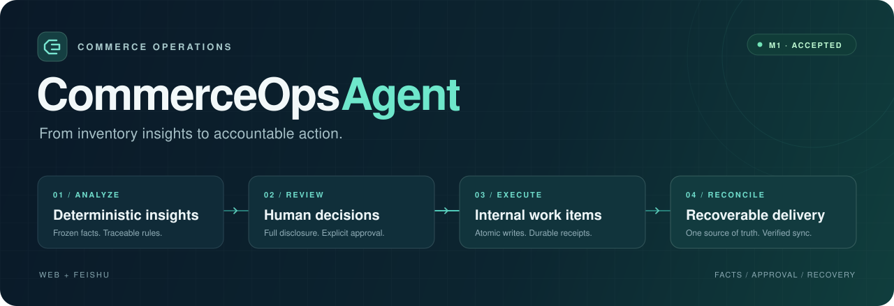
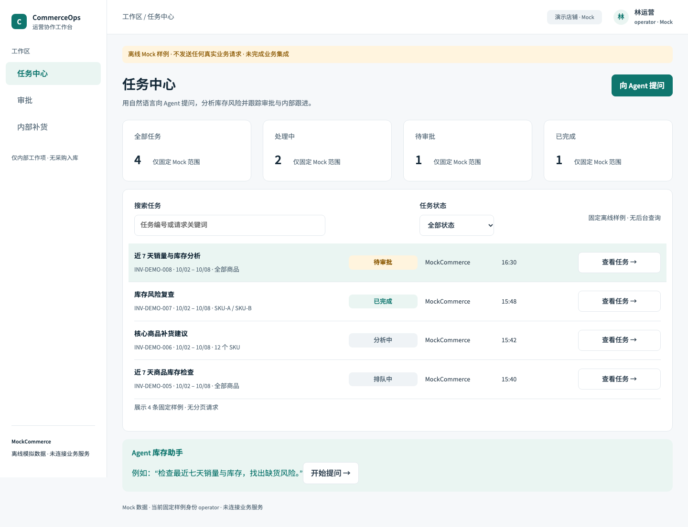
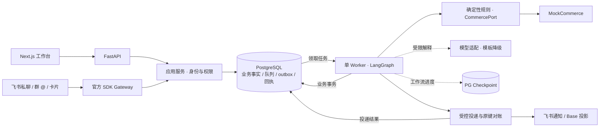

<div align="center">



# CommerceOps Agent

**让库存分析、人工决策与运营执行，形成一个可追溯的闭环。**

面向电商运营的 AI Agent 应用 · Web × 飞书 · 确定性分析 · 可恢复执行

[](https://github.com/aning0922/commerceops-agent/issues/39#issuecomment-6360314990)


[产品体验](#产品体验) · [工程设计](#工程设计) · [快速开始](#快速开始) · [验收证据](#验收证据) · [文档导航](#文档导航)

</div>

CommerceOps Agent 把电商运营中分散的分析、审批和跟进连接起来：从一条库存分析请求开始，生成有数据依据的补货建议，由审批人确认完整计划，再创建内部补货工作项、同步飞书多维表格，并持续查询结果。

**确定性代码计算事实，模型辅助解释，人决定是否执行。** 每次状态变化都能关联到数据快照、计划版本、真实操作者和执行回执。当前 M1 已完成真实飞书测试环境中的业务闭环验收；业务数据来自 MockCommerce，执行范围是内部工作项的创建、完成与关闭。

## 产品体验

### 一条请求，贯穿分析、决策与跟进

```text
Web / 飞书私聊 / 群 @
        ↓
库存分析 → 风险与补货报告 → 冻结计划 → 人工审批
                                        ↓
查询与解释 ← Web / Base 同步 ← 内部补货工作项
```

| 环节 | 用户可以做什么 | 系统如何保证结果可信 |
| --- | --- | --- |
| 发起分析 | 通过 Web 确认参数，或在飞书提出库存分析请求、补齐澄清信息 | 有限意图与参数合同；确认完整后才创建正式任务 |
| 阅读报告 | 查看 SKU 风险、建议数量、数据质量与未知在途 | 冻结数据快照与确定性金标；模型解释受事实约束 |
| 作出决定 | 阅读完整计划，批准、拒绝或显式确认未知在途假设 | 校验当前角色、店铺、版本、hash、nonce 和有效期 |
| 跟进执行 | 查看内部项，填写原因后完成或关闭 | 全计划事务、持久幂等键、终态保护与审计 |
| 协同与查询 | 在飞书接收审批卡片、查询进度和报告解释，在 Base 跟进同步 | 业务状态与投递状态分别展示；未知结果先对账 |

### 工作台预览



*已实现的任务中心界面，截图来自 B01 离线 Mock 模式，使用演示身份和数据；用于展示页面结构，不代表当前真实平台运行现场。*

更多界面：[库存报告](frontend/evidence/b04-live/read/report-1440.png) · [390px 窄屏报告](frontend/evidence/b04-live/read/report-390.png) · [20 SKU 审批页](frontend/evidence/b04-live/write/assumptions-1280.png) · [业务与同步状态](frontend/evidence/p4-c09-reviewfix/c2-sync-390.png)。报告与审批页来自自有 Mock 数据的真实 PostgreSQL/API/Web 联调；同步状态图为离线 Fake 场景，来源详见 [Web 交接记录](docs/ux/phase4-implementation.md)。

想快速讲清项目，可以按 **发起请求 → 报告依据 → 完整审批 → 内部项 → 同步与轨迹** 演示，具体脚本见 [M1 交付与演示路线](docs/PHASE4_M1_DELIVERY.md)。

## 工程设计

### 把模型能力放在明确的业务边界内

模型用于受限解释与辅助路由，库存、金额、权限、幂等及状态变更由确定性代码负责。解释链有结构化输入、事实约束、调用预算和模板降级；模型异常不会变成虚构的执行成功。

### 让每一次批准都绑定明确的事实

报告、快照与计划版本保持不可变。审批绑定 `plan_version`、`plan_hash`、`nonce` 和有效期，服务端重新核验当前操作者权限。未知在途需要确认**当前版本的完整假设集合**；普通批准无法跳过。审批意见已受理、内部项已创建、外部同步已核实，是三个独立结果。

### 从持久化开始设计恢复

PostgreSQL 保存业务事实、队列、回执和 outbox 意图；LangGraph checkpoint 保存工作流进度。单 Worker、全局单 Graph 执行槽配合事务、唯一约束与持久幂等键，处理重复、冲突和进程中断。外部成功未知时按原键核对，旧投影不能覆盖新版本。



Base 是业务状态的协作投影，PostgreSQL 是权威来源。当前运行模型使用单 Worker；图中的模块表示职责分工，不代表多个调度器。

| 层次 | 技术选择 |
| --- | --- |
| Web | Next.js 16 · React 19 · TypeScript · Playwright |
| API 与领域 | Python 3.12 · FastAPI · Pydantic · 确定性库存规则 |
| 工作流与持久化 | LangGraph · PostgreSQL 17 · psycopg · Alembic |
| 集成边界 | CommercePort / MockCommerce · 飞书官方 SDK · Base 投影 |
| 工程质量 | uv / npm 锁文件 · Ruff · mypy · pytest · Gitleaks · GitHub Actions |

设计依据：[架构](docs/ARCHITECTURE.md) · [数据模型](docs/DATA_MODEL.md) · [Agent 与恢复设计](docs/AGENT_DESIGN.md) · [架构决策](docs/DECISIONS.md)。

## 快速开始

### 方式一：预览 Web 工作台

适合快速了解页面和角色流程。使用 **Python 3.12.13 / uv 0.11.25**；项目脚本将固定版本的 Node.js **24.21.0**、npm **11.19.0** 与 Gitleaks 准备到仓库 `.tools/`，不修改全局工具链。

```sh
git clone https://github.com/aning0922/commerceops-agent.git
cd commerceops-agent

uv sync --frozen
uv run --frozen python -m scripts.bootstrap_tools
PATH="$PWD/.tools/node/bin:$PATH" npm --prefix frontend ci --ignore-scripts

PATH="$PWD/.tools/node/bin:$PATH" \
  COMMERCEOPS_UI_MODE=mock \
  COMMERCEOPS_MOCK_ROLE=operator \
  NEXT_TELEMETRY_DISABLED=1 \
  npm --prefix frontend run dev
```

打开 [http://127.0.0.1:3000](http://127.0.0.1:3000)。将 `COMMERCEOPS_MOCK_ROLE` 改为 `approver` 或 `admin` 并重启，可查看对应角色样例。

此模式使用演示数据，无需数据库、模型密钥或飞书凭据，不产生业务写入。仓库当前为 Private，克隆需要访问权限；工具安装和冷缓存依赖下载需要网络。

### 方式二：运行完整离线业务闭环

使用 [M1 Compose 运行指引](docs/M1_OFFLINE_COMPOSE.md)，在新私有目录与独立 Compose 项目中启动 **PostgreSQL + API + 单 Worker + Next.js Web**：

1. 准备私有配置，构建镜像，执行迁移、checkpoint 初始化与运行角色授权。
2. 执行一次演示数据初始化，从本地受保护文件读取生成的测试账户。
3. 在 Web 创建新分析任务，查看 20 SKU 报告，显式确认完整假设并审批。
4. 核对内部补货项，完成或关闭同一工作项，再读取结果与操作轨迹。
5. 按指引停止自有服务，保留数据卷与测试证据。

这里的“离线”指关闭真实业务平台与模型调用：数据为 Mock、审批为模拟 Web 操作、投影为 `offline_fake`。需要 Docker/Compose 与 POSIX shell，完整命令和资源边界以运行指引为准；技术初始化数据不算一次新业务分析。

飞书真实联调需另行配置专用测试应用、身份映射、测试群和 Base，配置说明见 [飞书集成](docs/FEISHU_INTEGRATION.md)。秘密只放在本地受保护配置中。

## 验收证据

**M1 已于 2026-10-23 正式验收。** 已验收业务基线为 [`90ef500`](https://github.com/aning0922/commerceops-agent/commit/90ef500534f501dde8bb3247e783462951dcdb88)，同提交[合后 CI 五项作业成功](https://github.com/aning0922/commerceops-agent/actions/runs/39939441733)，阶段及子任务 #39–#42 已关闭。以下数字对应这次验收快照。

| 验证层次 | 已取得的证据 |
| --- | --- |
| PostgreSQL 与恢复 | **567 项实际 PG 测试**（391 + 176），G1 三项、G2 六项；含中断恢复、提交间隙与进程终止保护 |
| Web / API | 实际 PG/API 支撑的 read / write / items 测试及 N01 六项通过；覆盖权限、参数确认、页面操作、窄屏与规定的键盘检查 |
| 真人飞书业务 | 私聊与群 @ 闭环、关联澄清、拒绝与联合批准、重复与冲突；群卡完整披露 **20 SKU 和全部未知在途假设** |
| Base 与内部项 | 批准后 **20 个内部项 / 20 条 Base 记录**完整核对；独立拒绝零项；另有真人关闭同一工作项及同记录 v2 读回 |
| 查询与解释 | 两条新群查询唯一接收并各回复一次；模型事实约束与降级沿用已核证据 |
| 交付复现 | 干净 Compose 四场景的既有实际证据、源码影响核对、操作指引与演示资料 |

验收采用分层证据：真人每卡一次重复，十次重复、并发与故障恢复由实际 PG/原生路径验证；受控故障注入与真实平台结果分开记录。客户端已读与 raw wire ACK 未采集，既有 Compose 证据不宣称本提交重新执行过冷 clone。完整来源、独立审核及保留风险见 [最终结案回执](https://github.com/aning0922/commerceops-agent/issues/39#issuecomment-6360314990)与 [Phase4 验收报告](docs/PHASE4_ACCEPTANCE.md)。

## 里程碑

| 里程碑 | 范围 | 状态 |
| --- | --- | --- |
| **M1 · 核心 Agent 应用** | 库存分析、审批、内部工作项、Web、真实飞书与 Base 闭环 | **已验收** · Phase0–4 |
| M2 · 真实电商数据接入 | WooCommerce 测试店只读适配、数据对账、备份还原与完整 P0 交付 | 规划中 · Phase5 |
| M3 · 完整求职版本 | 日报与调度、受限动态只读工具、SOP RAG、文案审核草稿 | 规划中 · Phase6 |

当前不执行真实采购、支付、退款或库存修改。Woo 实店、生产部署及后续阶段尚未验收。路线与依赖见 [ROADMAP](docs/ROADMAP.md)及 [30 天交付计划](docs/plans/30_DAY_EXECUTION.md)；阶段文档中的历史快照由对应结案回执补齐。

## 开发与检查

```sh
# Markdown 本地链接与差异空白
uv run --frozen python -m scripts.check_docs

# 离线测试
uv run --frozen python -m pytest -m offline

# 前端类型检查
PATH="$PWD/.tools/node/bin:$PATH" npm --prefix frontend run typecheck

# 当前文件、暂存区与 Git 可达历史的敏感信息检查
uv run --frozen python -m scripts.scan_secrets
```

完整质量入口为 `uv run --frozen python -m scripts.check`。真实 PG、浏览器业务联调和平台测试分别准备环境、分别记录结果，详见 [开发说明](docs/DEVELOPMENT.md)、[测试计划](docs/TEST_PLAN.md)及 [CI 配置](.github/workflows/quality.yml)。

<details>
<summary><strong>仓库结构</strong></summary>

```text
commerceops-agent/
├── backend/
│   ├── src/commerceops/     # 领域规则、应用用例、工作流与适配器
│   └── migrations/         # 数据库版本迁移
├── frontend/               # Next.js 工作台、类型合同与界面证据
├── tests/                  # 离线、真实 PG、恢复与 Web 测试
├── scripts/                # 工具链、质量检查与隔离验证
├── docs/                   # 产品、架构、接口、UX 与验收资料
├── infrastructure/         # 固定版本的容器运行环境
├── compose.yml             # PostgreSQL 与初始化
└── compose.m1-offline.yml   # 完整离线业务演示装配
```

</details>

## 文档导航

| 阅读目的 | 入口 |
| --- | --- |
| 理解产品与演示 | [产品需求](docs/PRD.md) · [M1 交付与演示](docs/PHASE4_M1_DELIVERY.md) |
| 本地运行 | [完整 Compose 指引](docs/M1_OFFLINE_COMPOSE.md) · [开发说明](docs/DEVELOPMENT.md) |
| 理解业务一致性 | [架构](docs/ARCHITECTURE.md) · [数据模型](docs/DATA_MODEL.md) · [Agent 设计](docs/AGENT_DESIGN.md) |
| 阅读页面与接口合同 | [UX 索引](docs/ux/README.md) · [Web 合同](docs/contracts/p3-web-v1.md) · [P4 Web 交接](docs/ux/phase4-implementation.md) |
| 理解外部集成 | [飞书](docs/FEISHU_INTEGRATION.md) · [电商适配](docs/COMMERCE_INTEGRATION.md) |
| 核验完成情况 | [最终结案回执](https://github.com/aning0922/commerceops-agent/issues/39#issuecomment-6360314990) · [M1 验收](docs/PHASE4_ACCEPTANCE.md) · [项目状态](docs/STATUS.md) |

---

<div align="center">

**分析有依据 · 决策有授权 · 执行有回执 · 恢复可验证**

</div>
