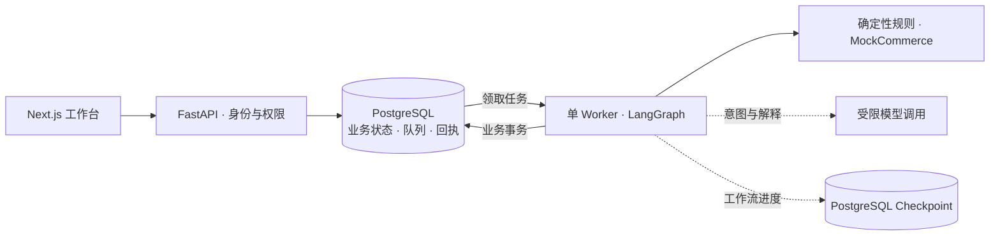

<div align="center">

# CommerceOps Agent

**从库存分析到人工审批，让电商运营任务有据可查。**

面向电商运营的 AI Agent 工作台 · 确定性分析 · 人工审批 · 可恢复执行


[界面预览](#界面预览) · [核心能力](#核心能力) · [快速开始](#快速开始) · [系统架构](#系统架构) · [项目进度](#项目进度) · [文档导航](#文档导航)

</div>

CommerceOps Agent 将库存风险分析、补货建议、审批决策和内部工作项放进同一个可追踪流程。运营人员查看分析与建议，审批人核对计划和风险，系统在执行前重新校验权限与数据，并保存操作回执和审计记录。

LLM 负责意图理解、结果解释和受限流程路由；库存计算、权限判断、幂等与状态变更由确定性代码完成。当前补货执行范围为**内部工作项的创建、完成和关闭**，不涉及真实采购、支付或库存修改。

## 界面预览


*任务中心的已实现界面，截图来自 B01 离线 Mock 模式。页面中的身份、数据和操作均为演示样例。*

更多界面：[库存分析报告](frontend/evidence/b01/report-1440.png) · [移动端报告](frontend/evidence/b01/report-390.png) · [真实 API 联调中的审批页](frontend/evidence/b04-live/write/assumptions-1280.png)。联调使用自有 Mock 业务数据与真实 PostgreSQL/API/Web，具体范围见 [Phase3 验收记录](docs/PHASE3_ACCEPTANCE.md)。

## 核心能力

| 能力 | 已实现内容 |
| --- | --- |
| 库存风险分析 | 根据销量、库存与在途数据运行确定性规则，生成补货建议、风险标记和不可变报告版本。 |
| Agent 辅助 | 支持固定意图与有限参数确认、报告解释、持久预算控制，以及受控模板降级。 |
| 人工审批 | 审批绑定计划版本、内容摘要与有效期；在途未知时，要求对当前版本的完整假设集合显式确认。 |
| 内部补货闭环 | 审批后重新校验，按整份计划原子创建内部工作项；支持带理由、版本校验的完成与关闭。 |
| 可靠执行 | 持久任务队列、单 Worker、LangGraph 中断与恢复；使用持久幂等键和原始回执处理重投与丢响应。 |
| Web 工作台 | 任务、报告、审批、内部补货及管理视图；按当前身份与店铺范围授权，支持移动端、键盘操作与 200% 缩放。 |

一次典型流程：

```text
提出分析请求 → 查看库存报告 → 冻结补货计划 → 人工审批
                                              ↓
跟踪工作项与审计 ← 创建内部补货项 ← 执行前重新校验
```

计划、身份或数据发生变化时，系统会阻止失效决定继续执行，并按合同要求重新确认；审批意见已记录与内部工作项已创建是两个独立状态。

## 快速开始

### 1. 准备环境

使用 **Python 3.12.13** 与 **uv 0.11.25**。项目工具脚本会将固定版本的 Node.js **24.21.0**、npm **11.19.0** 和 Gitleaks 安装到仓库的 `.tools/`，不修改全局工具链。只有数据库联调需要 Docker 与 Compose。

```sh
git clone https://github.com/aning0922/commerceops-agent.git
cd commerceops-agent

uv sync --frozen
uv run --frozen python -m scripts.bootstrap_tools
PATH="$PWD/.tools/node/bin:$PATH" npm --prefix frontend ci --ignore-scripts
```

仓库当前为 Private，克隆需要对应访问权限。依赖由 `uv.lock` 与 `frontend/package-lock.json` 固定。

### 2. 预览 Web 工作台

从仓库根目录启动显式 Mock 模式，无需数据库、模型密钥或飞书凭据：

```sh
PATH="$PWD/.tools/node/bin:$PATH" \
  COMMERCEOPS_UI_MODE=mock \
  COMMERCEOPS_MOCK_ROLE=operator \
  NEXT_TELEMETRY_DISABLED=1 \
  npm --prefix frontend run dev
```

打开 [http://127.0.0.1:3000](http://127.0.0.1:3000)。将启动变量 `COMMERCEOPS_MOCK_ROLE` 改为 `approver` 或 `admin` 并重启，可查看对应角色样例。Mock 模式用于界面演示，不连接业务 API，也不产生真实审批或补货记录。

### 3. 启动 API 基础入口

在另一个终端从仓库根目录执行：

```sh
uv run --frozen commerceops-api
```

检查进程存活：

```sh
curl --fail http://127.0.0.1:8000/health/live
# {"status":"ok","service":"commerceops-api"}
```

这个启动方式用于确认 API 进程可用；完整业务联调还需独立 PostgreSQL、迁移、Worker 和显式私有配置。数据库初始化见 [开发说明](docs/DEVELOPMENT.md#p1-02-postgresql-与一次性初始化)，会话、权限及业务 API 见 [Phase3 Web 合同](docs/contracts/p3-web-v1.md)，前端接线与测试见 [Web 实施记录](docs/ux/phase3-implementation.md)。

## 系统架构



- **业务事实持久化**：PostgreSQL 保存业务状态、幂等回执与审计；LangGraph checkpoint 保存工作流进度，不能替代业务事务。
- **副作用有明确边界**：执行前校验当前身份、权限、计划版本及数据；整份计划原子执行，重试复用持久执行记录。
- **并发与恢复可控**：当前采用单 Worker、全局单 Graph 执行并发；恢复时校验旧进程终止状态，保留中断与失败证据。

| 层次 | 技术 |
| --- | --- |
| Web | Next.js 16、React 19、TypeScript、Playwright |
| API 与业务 | Python 3.12、FastAPI、Pydantic |
| 工作流 | LangGraph、独立 Worker、PostgreSQL 持久队列 |
| 数据与迁移 | PostgreSQL 17、SQLAlchemy、psycopg、Alembic |
| 集成 | MockCommerce、飞书官方 SDK；正式平台业务接入按阶段推进 |
| 工程质量 | uv / npm 锁文件、Ruff、mypy、pytest、Gitleaks、GitHub Actions |

详细设计见 [架构](docs/ARCHITECTURE.md)、[数据模型](docs/DATA_MODEL.md)与 [Agent 及恢复设计](docs/AGENT_DESIGN.md)。

## 项目进度

**截至 2026-10-18，`main` 已完成 Phase3 验收；Phase4 在独立 PR 中开发，尚未合入 `main`。**

| 阶段 | 交付重点 | 状态 |
| --- | --- | --- |
| Phase0 | 产品需求、架构、数据与测试规划 | 已结案 |
| Phase1 | 工程底座、PostgreSQL、持久 Worker、Checkpoint 与有限飞书技术探针 | 已结案 |
| Phase2 | 确定性库存分析、不可变报告、受限意图与解释 | 已结案 |
| Phase3 | Web 会话与权限、人工审批、内部补货项与恢复闭环 | 已验收并合入 `main` |
| Phase4 | 正式飞书业务接入、Base 投影与 Web 扩展 | 开发中：[PR #43](https://github.com/aning0922/commerceops-agent/pull/43) · [#44](https://github.com/aning0922/commerceops-agent/pull/44) · [#45](https://github.com/aning0922/commerceops-agent/pull/45) |

Phase3 结案基线为 `9d97c19`。该提交的[四项 CI 检查](https://github.com/aning0922/commerceops-agent/actions/runs/38093693335)均通过，记录了 **1,057 项离线测试、337 项真实 PostgreSQL 测试和 24 项真实 API/Web 自动化测试**。这些是指定提交的历史验收结果，使用 Mock 业务数据与自动化测试身份；详情以 [Issue #33 结案回执](https://github.com/aning0922/commerceops-agent/issues/33#issuecomment-6103315682)为准。

当前已验收范围不包含真实飞书 Card/Base 业务外写、WooCommerce 实店、生产部署或 M1 整体验收。历史失败、未验证项目和已接受风险继续保留在 [STATUS](docs/STATUS.md) 与 [Phase3 验收记录](docs/PHASE3_ACCEPTANCE.md)；文档中的阶段收口快照应结合对应 Issue 的后续回执阅读。

## 开发与检查

从仓库根目录运行：

```sh
# 文档链接与差异空白
uv run --frozen python -m scripts.check_docs

# 确定性离线测试，不连接外部服务
uv run --frozen python -m pytest -m offline

# 前端类型检查
PATH="$PWD/.tools/node/bin:$PATH" npm --prefix frontend run typecheck

# 可提交文件、暂存区与 Git 可达历史的敏感信息检查
uv run --frozen python -m scripts.scan_secrets
```

完整质量检查入口为 `uv run --frozen python -m scripts.check`。真实 PG、浏览器业务联调和外部平台测试分别准备环境、分别记录证据；离线通过不替代集成验收。流程见 [开发说明](docs/DEVELOPMENT.md)、[测试计划](docs/TEST_PLAN.md)与 [CI 配置](.github/workflows/quality.yml)。

## 仓库结构

```text
commerceops-agent/
├── backend/
│   ├── src/commerceops/     # 领域规则、应用用例、工作流、适配器与入口
│   └── migrations/         # 数据库版本迁移
├── frontend/               # Next.js 工作台、类型合同与界面证据
├── tests/                  # 离线、PostgreSQL、恢复与 Web 集成测试
├── scripts/                # 工具链、质量检查与隔离测试工具
├── docs/                   # 产品、架构、接口合同、UX 与验收记录
├── infrastructure/         # 容器运行环境
└── compose.yml             # 本地 PostgreSQL 与初始化配置
```

## 文档导航

| 想了解什么 | 从这里开始 |
| --- | --- |
| 产品解决什么问题 | [产品需求](docs/PRD.md) · [路线图](docs/ROADMAP.md) |
| 如何运行与开发 | [开发说明](docs/DEVELOPMENT.md) · [工程约束](AGENTS.md) |
| 如何保证一致性与恢复 | [架构](docs/ARCHITECTURE.md) · [数据模型](docs/DATA_MODEL.md) · [Agent 设计](docs/AGENT_DESIGN.md) |
| 页面与接口如何协作 | [UX 文档](docs/ux/README.md) · [Web 合同](docs/contracts/p3-web-v1.md) · [前端实施](docs/ux/phase3-implementation.md) |
| 外部平台如何接入 | [飞书集成](docs/FEISHU_INTEGRATION.md) · [电商适配](docs/COMMERCE_INTEGRATION.md) |
| 已经验证到哪一步 | [项目状态](docs/STATUS.md) · [Phase2 验收](docs/PHASE2_ACCEPTANCE.md) · [Phase3 验收](docs/PHASE3_ACCEPTANCE.md) |
| 为什么这样设计 | [架构决策](docs/DECISIONS.md) · [调研证据](docs/RESEARCH.md) · [复用审计](docs/REUSE_AUDIT.md) |

开发通过独立分支、PR、独立审核与精确提交的 CI 留下可追溯记录；合并与阶段推进遵循 [AGENTS.md](AGENTS.md) 中的授权和验收约束。
