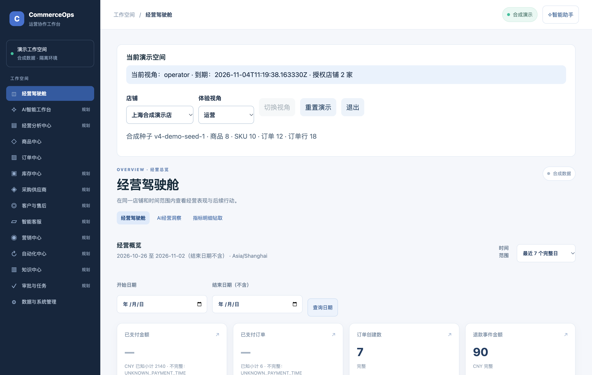
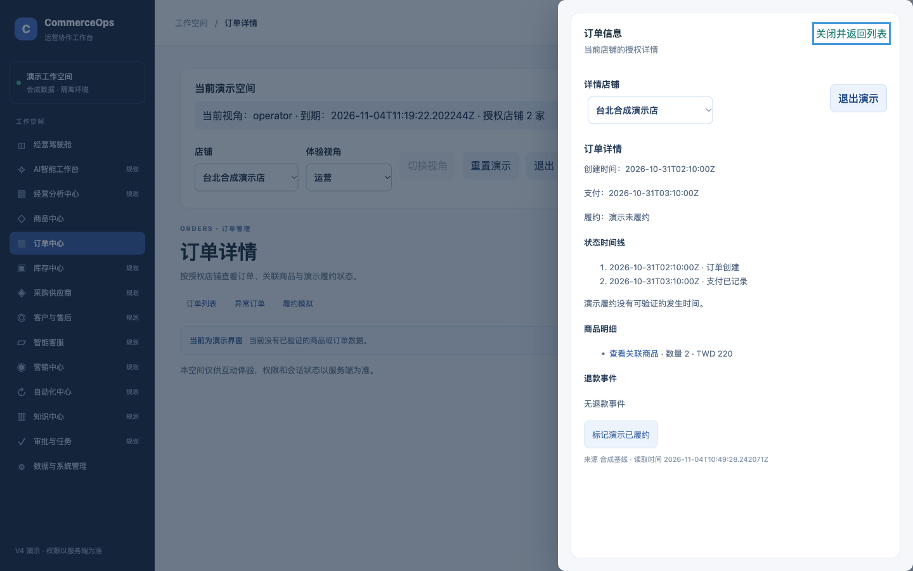
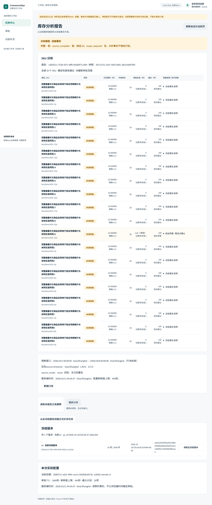
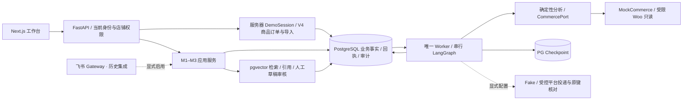

<div align="center">

# CommerceOps Agent

**从经营数据到运营行动，让分析有依据、决策有授权、执行有回执。**

电商运营工作台 · 确定性分析 · 人工审批 · 可恢复执行


[产品展示](#产品展示) · [Agent 能力](#agent-能力) · [架构与技术栈](#架构与技术栈) · [本地体验与部署](#本地体验与部署) · [验证与交付](#验证与交付) · [文档导航](#文档导航)

</div>

CommerceOps Agent 面向电商运营中的三类工作：看清当前店铺的经营事实，管理商品与订单，将库存风险转成经过人工批准的内部补货工作项。项目把 Web 工作台、确定性规则、持久工作流和投递回执连接起来，也提供受限只读询单、日报和知识检索后的内部文案审核。

**截至 2026-11-04，V4-1 六卡本地阶段已完成，当前暂停功能开发，进入阶段归档。** 当前产品展示使用合成店铺数据：经营看板、商品／订单管理、CSV／XLSX 商品导入、当前页批量标签及演示履约已经在自有本地 API、PostgreSQL 和浏览器中验证。正式范围与限制见 [V4-1 交付核收](docs/v4/acceptance/v4-1/REVIEW.md)。全部临时服务已关闭，当前没有常驻公网 Demo；V4-2 未启动。

## 产品展示

### 经营驾驶舱：指标可以追到明细与来源



*真实本地运行原图，使用合成演示数据。图中是规定视口内的驾驶舱，保留了付款时间未知导致指标不完整的提示；不将已知小计包装成完整收入。*

同一店铺、时区、币种、期间与数据版本贯穿看板、趋势、指标钻取、列表、详情和导出。金额使用 Decimal；TWD 与 CNY 分别核算，不跨币种相加。缺少付款时间、成本或库存时展示未知原因，不虚构毛利、真实结算或可售库存。

“AI 经营洞察”当前由确定性规则产生，建议不直接创建正式任务。全局 Copilot 已有容器、上下文和状态边界，当前显示**模型未启用**；页面名称和助手入口不代表已接入真实模型。

### 商品与订单：查找、关联、确认，再读回结果



*真实本地 API／PG／Web 截图；订单、金额与商品均为合成数据。时间线只展示已知创建、支付和退款事实，演示履约不生成真实物流记录。*

商品中心支持名称／SKU 搜索、标签和来源筛选、稳定分页、SKU 规格、详情关联以及安全 CSV 导出。标签编辑使用版本校验，当前页可显式多选并串行完整替换标签，空集合表示清空。批量操作可能部分成功，首错、取消或未知结果会停止余下项目；已提交的单项不会随其他项目失败回滚，不提供跨页或全店批量操作。

订单中心支持期间、支付与履约筛选、分页、导出和关联商品。异常订单页当前展示付款时间未知等事实筛选，未实现持久异常标记；付款时间未知不等同于真实未付款。履约操作只修改当前演示空间覆盖层，不写 Woo、不改库存、资金或真实物流。

### CSV／XLSX：先检查，再明确确认导入

上传商品文件后，系统依次执行格式发现、字段映射、安全样本和质量预览。用户核对后明确确认，才原子创建当前演示店铺的新商品与 SKU；随后可在列表、详情和同源商品数中读回。预览不产生正式商品，失败不部分导入。

支持 CSV 和受支持的单 worksheet XLSX，当前不导入订单、客户、退款或库存，不做 upsert。商品与订单导出为安全 CSV，不是 XLSX 导出。标签、履约和导入的未知提交结果都保留原请求键，只读核对原操作，不自动换键重发。

[商品列表原图](docs/v4/acceptance/v4-1/BROWSER_SCREENSHOTS/browser-business/product_list-1440.png) · [CSV 映射原图](docs/v4/acceptance/v4-1/BROWSER_SCREENSHOTS/browser-business/csv_mapping-1440.png) · [XLSX 映射原图](docs/v4/acceptance/v4-1/BROWSER_SCREENSHOTS/browser-business/xlsx_mapping-1440.png) · [390px 批量确认](docs/v4/acceptance/v4-1/BROWSER_SCREENSHOTS/browser-business/batch_confirm-390.png) · [390px 导入读回](docs/v4/acceptance/v4-1/BROWSER_SCREENSHOTS/browser-business/xlsx_readback-390.png)

### 演示身份由服务端管理

V4-0 建立了服务器 DemoSession：从 `/v4` 点击“一键体验”，访客获得自己的合成组织、两家店铺和演示身份。服务端管理 HttpOnly Cookie、当前身份、店铺授权与 30 分钟绝对期限；切换视角、重置和退出都有明确控制动作，重置不会延长期限。UI 角色选择不能自行授予权限，受限管理员没有默认业务店铺。

不同访客的数据隔离；切店、身份变化、到期或退出时清除旧上下文。重置推进演示代次并清理覆盖层，旧请求不能写入新代次。演示空间不使用公共固定账号密码，也不复用历史验收会话。

### 六卡交付与当前页面范围

| V4-1 卡片 | 已完成的本地合同范围 |
| --- | --- |
| V41-01 · Shell | 14 模块导航、主题、加载／空／错误／恢复状态、菜单和焦点交互，未开放类别明确标注 |
| V41-02 · 同源指标 | KPI、店铺时区／币种／期间、确定性金额口径与明细钻取 |
| V41-03 · 经营工作台 | 经营首页、图表、规则洞察、异常待办展示和 Copilot 容器，模型关闭 |
| V41-04 · 商品／订单接口 | 当前授权列表与详情、标签和演示履约覆盖层 |
| V41-05 · 管理界面 | 详情关联、筛选分页、安全导出、当前页批量标签、身份与店铺切换清屏 |
| V41-06 · 商品导入 | CSV／XLSX 发现、映射、质量预览、原子确认、原键恢复与来源读回 |

当前 **12 个业务视图**：

| 分区 | 路由 |
| --- | --- |
| 经营首页、规则洞察、指标钻取 | `/v4/dashboard` · `/v4/insights` · `/v4/dashboard/drilldown` |
| 商品列表、详情 | `/v4/products` · `/v4/products/:productId` |
| SKU 规格、分类标签、商品导入 | `/v4/products/variants` · `/v4/products/categories` · `/v4/products/import` |
| 订单列表、详情、异常订单、履约模拟 | `/v4/orders` · `/v4/orders/:orderId` · `/v4/orders/anomalies` · `/v4/orders/fulfillment-demo` |

详情 ID 须从当前授权列表取得；“分类标签”当前展示标签覆盖层，不代表提供完整分类树。14 个导航还包括演示设置入口 `/v4/settings/demo`，以及明确标为规划的 AI 智能工作台、经营分析中心、库存中心、采购供应商、客户与售后、智能客服、营销中心、自动化中心、知识中心、审批与任务。导航可见不等于其业务已实现；本阶段不宣称原规划 99 项功能或 66 个业务页面全部完成。完整路由与步骤见 [复现说明](docs/v4/v4-1/proposals/LOCAL_DEMO_REPRODUCTION.md)。

本节 V4-1 产品图均来自已公开的 [40 张运行原图](docs/v4/acceptance/v4-1/BROWSER_SCREENSHOTS/INDEX.json)，不是设计稿。已有 1440／1280／390 视口与规定页面的原生 200% 缩放证据；390px 是浏览器视口，真机触摸和用户人工视觉审批未运行，部分表格右列需横向滚动。截图不代表全部规划页面覆盖。

## Agent 能力

工作台之外，M1–M3 保留了从分析到人工决策、内部执行与查询的业务链。V4 导航中标为规划的类别，不意味着这些旧工作流已全部迁入 V4 页面。

```text
Web / 飞书请求 → 参数确认 → 确定性库存分析 → 冻结报告与计划
                                                    ↓
进度与证据查询 ← 内部工作项与同步回执 ← 人工批准 / 拒绝
```

| 阶段 | 实现能力 | 已取得的证据与使用边界 |
| --- | --- | --- |
| M1 · 库存 Agent | 风险与补货报告、完整未知在途假设确认、人工审批、内部补货项完成／关闭、飞书查询及 Base 投影 | 2026-10-23 已验收，含当时真实飞书测试环境和真人业务链；电商数据为 MockCommerce，执行对象为内部工作项。历史平台证据不代表当前 V4-1 再次外发 |
| M2 · Woo 只读与恢复 | 来源绑定的 Woo 只读采集、质量阻断、待审批备份恢复、恢复后显式批准与新周期 | 阶段已结案（Issue #49 closed/completed）；本地真实 Woo 合成测试店、PG／HTTP／浏览器及备份恢复证据，不代表商业实店、采购或库存写入。旧技术快照中的待收口文字保留其时点，当前以固定结案记录为准 |
| M3 · 日报／询单／知识草稿 | 确定性日报、持久调度与 Fake 投递、模板追问和证据分页；受预算约束的只读工具；SOP 检索、引用和指定审核人批准内部草稿 | 本地实施与验证已核收；询单使用 `offline_stub`，知识使用本地 pgvector 与合成向量／资料。批准只保存内部草稿，不发布；真实资料、模型／embedding 和外发验收延后 |



*补充展示 M1 报告流程：自有 Mock 数据的真实本地 PG／API／Web 联调原图，属于历史 M1 证据，不是 V4-1 页面或本轮飞书现场。*

模型适配与事实约束是工程能力的一部分，当前 V4-1 运行不调用真实 provider。库存、金额、权限和状态变更由确定性代码负责；模型辅助解释不能修改业务数值或替代人工批准。

[M1 交付与演示](docs/PHASE4_M1_DELIVERY.md) · [M1 验收](docs/PHASE4_ACCEPTANCE.md) · [M2 技术验收](docs/PHASE5_ACCEPTANCE.md) · [M2 固定结案入口](https://github.com/aning0922/commerceops-agent/issues/49#issuecomment-6430237354) · [M3 本地验收](docs/M3_LOCAL_ACCEPTANCE.md)

## 架构与技术栈



PostgreSQL 是业务权威，Base 是协作投影，LangGraph checkpoint 保存工作流进度。原业务采用单 Worker、全局单 Graph 串行槽；V4 演示读写是有限 API／PG 请求，不为每个访客启动 Worker 或 Graph。商品文件解析使用受限独立子进程与持久准入，不借此增加业务调度器。

权限、版本和幂等在提交前重新核对；业务效果、回执和事件同事务保存。提交结果未知时按原键读取，缺少回执不推断事务已回滚。审批还绑定不可变快照、计划版本／hash、nonce 和期限；版本变化不能沿用旧批准。M3 草稿审核与检索复用身份及来源约束，当前不产生发布任务。

| 层 | 仓库锁定技术 |
| --- | --- |
| 前端 | Next.js **16.4.2** · React **19.3.0** · TypeScript **7.0.2** · Playwright **1.64.0** |
| API／领域 | Python **3.12.13** · FastAPI **0.142.4** · Pydantic **2.13.5** · Uvicorn |
| 工作流／持久化 | LangGraph **1.2.14** · PostgreSQL **17.11** · psycopg · SQLAlchemy · Alembic |
| 知识与集成 | pgvector **0.8.7** · CommercePort · MockCommerce · Woo 只读适配 · 飞书官方 SDK |
| 工具链／质量 | uv **0.11.25** · Node.js **24.21.0** · npm **11.19.0** · Ruff · mypy · pytest · Gitleaks |

依赖以 [Python 配置](pyproject.toml)、[前端配置](frontend/package.json)及锁文件为准。设计背景见 [架构](docs/ARCHITECTURE.md)、[数据模型](docs/DATA_MODEL.md)、[Agent 与恢复设计](docs/AGENT_DESIGN.md)。

## 本地体验与部署

### 准备锁定依赖

下面是依赖准备命令；冷缓存需要网络。需要 Python 3.12.13、uv 0.11.25，完整业务演示还需 Docker／Compose 和按运行指引准备的镜像、私有配置与浏览器工具。脚本将 Node／npm 等工具放入仓库 `.tools/`。

```sh
git clone https://github.com/aning0922/commerceops-agent.git
cd commerceops-agent
uv sync --frozen
uv run --frozen python -m scripts.bootstrap_tools
PATH="$PWD/.tools/node/bin:$PATH" npm --prefix frontend ci --ignore-scripts
```

### 体验当前 V4-1 业务

当前提供受控本地复现流程，尚无公开一键常驻部署器。按 [V4-1 最终复现说明](docs/v4/v4-1/proposals/LOCAL_DEMO_REPRODUCTION.md)准备新环境：

1. 固定干净 checkout 的 source／tree 和工具摘要，准备同源镜像、新 PG／API／Web 资源、私有配置、端口、绝对 UTC 窗口与清理责任人。旧案 once、凭据、卷和过期窗口不能直接接续。
2. 执行迁移至 `0025`、checkpointer 初始化、runtime 授权、V4 合成 fixture 初始化／授权／校验，再激活并核验 V4-1 policy。仅数据库健康不等于应用就绪。
3. 在新案 API／Web 归属和 readiness 通过后，打开 `http://127.0.0.1:<本案web_port>/v4`，点击“一键体验”，显式选择当前授权店铺。端口取本案实际配置，无固定公共登录密码。
4. 按“看板与钻取 → 商品详情与标签 → 订单关联与演示履约 → CSV／XLSX 映射、确认及来源读回”体验。批量标签只选当前页，退出或重置前先核实未决操作。
5. 结束时停止全部 writers，采集逐键末态，再关闭本案容器、网络、端口和进程并核实保卷。自动验收 driver 完成后会关闭服务，不留下可持续访问 URL。

公开入口的命令形状如下，路径须换成本次已核收的新案材料；`prepare` 不启动服务，`execute` 还需要实际窗口和外层监督，单个旗标不授予运行权限：

```sh
.venv/bin/python -m tests.e2e.v41.owned_driver prepare --case /ABS/ROOT_NEW_MANIFEST.json
.venv/bin/python -m tests.e2e.v41.owned_driver execute --case /ABS/NEW_CASE/case.json --root-opened-window
```

主 API 通过 `COMMERCEOPS_V4_DEMO_CONFIG_FILE` 加载显式启用的 Demo 配置；V4 前端读取 `COMMERCEOPS_API_ORIGIN`，本机 loopback HTTP 还需显式 `COMMERCEOPS_WEB_TRANSPORT=local_http`。这些配置不替代数据库授权或私有密钥准备；完整字段、镜像与进程监督要求以复现说明为准。

### 预览历史 M1 工作台

如果只想快速看旧任务中心／角色样例，可运行独立 Mock UI，无需数据库或平台密钥：

```sh
PATH="$PWD/.tools/node/bin:$PATH" \
  COMMERCEOPS_UI_MODE=mock \
  COMMERCEOPS_MOCK_ROLE=operator \
  NEXT_TELEMETRY_DISABLED=1 \
  npm --prefix frontend run dev
```

打开 [http://127.0.0.1:3000](http://127.0.0.1:3000)。`approver`／`admin` 可替换上面的 Mock 角色后重启；这展示历史 M1 页面样例，不会启动 V4-1 后端或创建真实业务数据。

### 完整业务与部署资料

| 目标 | 运行指引 |
| --- | --- |
| 历史 M1 Mock 数据完整闭环 | [M1 Compose](docs/M1_OFFLINE_COMPOSE.md)：仅适用于已验 `8ad436595794ef83f3a99bc80bd9ad4948b7117e` 的 0018 环境；PG + API + 单 Worker + Web，包含分析、审批、内部项与 Fake 投影。当前源码不能直接照搬 stock PG 与旧迁移预期 |
| M3 本地应用与向量库 | [M3 配置与启动](docs/M3_LOCAL_DELIVERY.md)：固定 PG17.11／pgvector0.8.7、显式应用开关及 owner 授权；当前无公开一键联合 seed CLI |
| V4-1 当前产品与验收复现 | [最终复现说明](docs/v4/v4-1/proposals/LOCAL_DEMO_REPRODUCTION.md)：新 owned 资源、0025、policy、真实浏览器与关闭采集 |
| 外部集成合同 | [飞书集成](docs/FEISHU_INTEGRATION.md) · [电商适配](docs/COMMERCE_INTEGRATION.md)，接入材料不代表外部验收已完成 |

基础 [compose.yml](compose.yml) 使用 stock PostgreSQL；M3 向量库显式叠加 [compose.m3.yml](compose.m3.yml)，先同源构建与绑定再使用，不是单独 `compose up` 即可运行完整应用。V4-1 当前真实 provider／embedding、飞书外发、Woo 写入、Hosted 和生产部署均 **NOT_RUN**。M1 历史飞书验收仍按原阶段来源保留；本 README 不将其转记为当前 V4-1 外部通过。

## 验证与交付

V4-1 的权威包为 [REVIEW](docs/v4/acceptance/v4-1/REVIEW.md)、[QA_RESULTS](docs/v4/acceptance/v4-1/QA_RESULTS.json) 和 [MANIFEST](docs/v4/acceptance/v4-1/MANIFEST.json)。业务代码冻结于 `261f39904d8cd5a3d6ae070cdca4a7ae5cde4d6e`，后续归档文档不改变测试来源。

| 证据层 | 精确源码与已核范围 |
| --- | --- |
| 完整工程 | `4fec4a7`：4601 离线通过；只属于该原源码，未在最终 261 重跑 Full |
| 完整 PG | `e7aeeca`：596 + 177 = 773 实际通过，严格配对并集 773／交集 0；只属于 e7 |
| 有限真实 HTTP | `54ab68f`：看板、商品订单、CSV、XLSX 四案；命令记录不计作测试数量 |
| 最终影响检查 | `261f399`：235 Python、74 Node、40 Native 纯组件、TypeScript 与 33 Mock 交互通过；Native 组件不启动浏览器 |
| 最终真实浏览器 | 同 `261f399` 的 r10：双 spec 通过、11 业务请求键（含 10 个移动端子集）、逐键 SQL 与独立清理核收；40 原图 AI 工程视觉审查通过 |

各层数量不相加，不把历史 Full／PG／HTTP 标为最终 SHA 的重跑。旧失败、UNKNOWN、清理退出和未采集字段保留：包括 r9 双 spec 通过但父失败、r10 API 清理 130、执行 summary 未写入、Native 独立 browser exit 未暴露。人工视觉、真机触摸、自然 24h GC 和外部／生产验收仍有明确未运行范围，详见 [风险](docs/v4/acceptance/v4-1/RISKS.md)。

开发时可按变更范围执行：

```sh
uv run --frozen python -m scripts.check_docs
uv run --frozen python -m pytest -m offline
PATH="$PWD/.tools/node/bin:$PATH" npm --prefix frontend run typecheck
uv run --frozen python -m scripts.scan_secrets
```

完整质量入口为 `uv run --frozen python -m scripts.check`；PG、浏览器与平台验证分别准备环境和记账。本次归档复用上述运行 Gate，新增文档、交付哈希及前端镜像文件布局的离线 schema 检查；完整镜像构建未重跑，详见[主线集成说明](docs/v4/archive/V41_MAIN_INTEGRATION.md)。

## 文档导航

| 阅读目的 | 入口 |
| --- | --- |
| 当前产品范围与操作 | [V4-1 六卡](docs/v4/v4-1/STAGE_SPEC.md) · [复现说明](docs/v4/v4-1/proposals/LOCAL_DEMO_REPRODUCTION.md) · [逐功能状态](docs/v4/acceptance/v4-1/FEATURE_STATUS.json) |
| 当前验收与真实截图 | [交付核收](docs/v4/acceptance/v4-1/REVIEW.md) · [质量结果](docs/v4/acceptance/v4-1/QA_RESULTS.json) · [40 图索引](docs/v4/acceptance/v4-1/BROWSER_SCREENSHOTS/INDEX.json) |
| Agent 业务和演示 | [M1 交付](docs/PHASE4_M1_DELIVERY.md) · [M2 技术快照](docs/PHASE5_ACCEPTANCE.md) · [M3 本地交付](docs/M3_LOCAL_DELIVERY.md) |
| 架构与一致性 | [架构](docs/ARCHITECTURE.md) · [数据模型](docs/DATA_MODEL.md) · [Agent 设计](docs/AGENT_DESIGN.md) · [决策记录](docs/DECISIONS.md) |
| 本地开发 | [开发说明](docs/DEVELOPMENT.md) · [测试计划](docs/TEST_PLAN.md) · [历史 0018 M1 Compose](docs/M1_OFFLINE_COMPOSE.md) |
| 阶段与历史 | [V4 文档入口](docs/v4/README.md) · [主线集成说明](docs/v4/archive/V41_MAIN_INTEGRATION.md) · [项目状态](docs/STATUS.md) · [路线图](docs/ROADMAP.md) · [M3 本地验收](docs/M3_LOCAL_ACCEPTANCE.md) |
