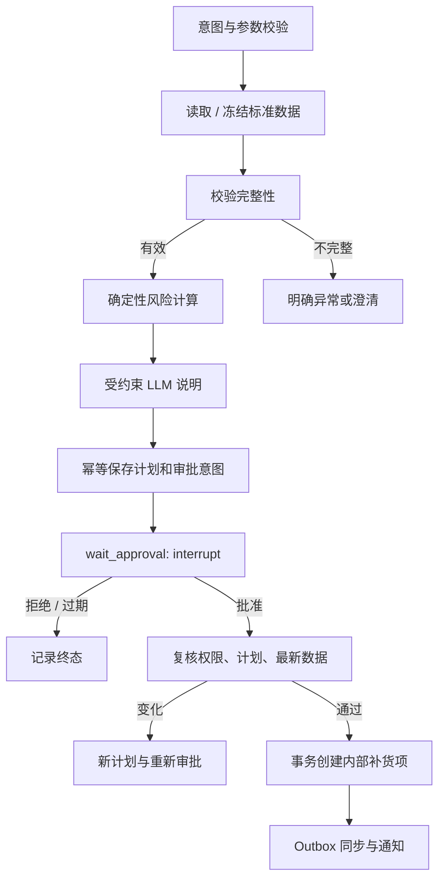

# Agent、Tool、Skill 与恢复设计

状态：待实现。本文伪流程用于架构评审，未执行 LangGraph 实验。

## 1. 四类责任

| 概念 | 本项目责任 | 不允许承担 |
|---|---|---|
| Agent | 自然语言意图、参数澄清、选择已注册业务流程、解释已有报告 | 自行授权、发明工具、自由迭代直到“成功” |
| Workflow | 显式状态、分支、审批中断、恢复与可观测性 | 将业务真值仅放进模型上下文 |
| Tool | 有类型 I/O 的业务用例调用，有超时、权限、错误和审计 | 根据模型传入的 role/approved 字段越权 |
| Skill | 版本化 SOP、术语、风险说明、报告和执行约束 | Markdown 授权替代代码、自动运行未知脚本 |

单主 Agent 的路由集合先为 `inventory_replenishment / task_status / explain_report / clarify / unsupported`。P1 才注册日报和文案流程。单组织少用户不需要多 Agent 协商或通用规划器。

## 2. Graph 状态

`InventoryState` 建议为 TypedDict，入口/工具/持久数据通过 Pydantic 验证，包含：schema_version、workflow_version、task_id、conversation_id、intent、normalized_params、snapshot_id、report_id、plan_id、plan_hash、approval_id、decision_ref、execution_id、outcome、error_code、trace_id。

只存必要标识与小型摘要，不把订单全集、密钥、卡片 token 或所有日志放进 checkpoint。可信 ExecutionContext（principal、organization/shop、trace、worker_owner）由 Worker 构造，每个用例重新查权限；恢复时不得信任 checkpoint 内旧角色。状态中的 approved 字样不能授权。初始仅单 Worker、全局一个 Graph 调用，所有图工作都经串行队列；lease_epoch/fencing 属于后续 C-EXT 扩展。

会话消息及摘要在业务表持久化：默认最近 10 条加一个摘要，摘要不改变已冻结计划。追问引用 task_id/report_id；有歧义先澄清，不猜测群里上一位用户的任务。已审批计划的参数修改产生新版本和新审批。

## 3. 节点与执行链



| 节点 | 输入→输出 | 重放策略 |
|---|---|---|
| interpret | 文本+允许意图→类型化参数 | 已记录结果可复用；不调用写工具 |
| collect | 窗口/范围→immutable snapshot_id | 同 attempt 完整快照复用；失败的新采集不能覆盖旧证据 |
| calculate | snapshot+rule→facts/report | 纯函数，可重复计算 |
| narrate | 事实→受限 explanation | 记录模型调用，校验失败最多修复一次；仍失败用确定性模板并标识 |
| prepare_approval | report→plan/approval ids | 按 task+plan_version 唯一；仅保存外发意图 |
| wait_approval | approval id/hash→decision_ref | 单个固定位置 interrupt；节点无外部写副作用 |
| revalidate | decision_ref+最新状态→允许/失效 | 查 DB 决定与权限；重新抓取受影响 SKU 和完整必要销售事实 |
| execute | 有效计划→execution_id | 调用事务幂等用例，已有回执直接返回 |
| finish | execution/outbox refs→业务结果 | 投影状态和通知由 outbox 收敛 |

无风险项时跳过审批，输出 no_action；数据不足可以完成说明报告但不可执行。LLM 失败可降级结构化报告，真实 LLM 演示验收必须至少成功一次，不能全部以模板替代。

## 4. LangGraph 中断语义

官方确认：`interrupt()` 使图暂停；恢复使用相同 thread_id 和 `Command(resume=...)`，中断所在节点从开头重执行。多个 interrupt 按调用顺序匹配，因此不能在版本升级时随意改变顺序。payload 必须可序列化，不能用宽泛 try/except 吞掉 GraphInterrupt。见 [Interrupts](https://docs.langchain.com/oss/python/langgraph/interrupts) 与 [API reference](https://reference.langchain.com/python/langgraph/types/interrupt)。

本项目使用 `AsyncPostgresSaver` 和 `durability="sync"`，在进入下一步前保存 checkpoint。首次 setup 是部署初始化动作，不由每个请求执行。内存 checkpointer 只用于纯单元测试。见 [Checkpointers](https://docs.langchain.com/oss/python/langgraph/checkpointers) 与 [Postgres memory](https://docs.langchain.com/oss/python/langgraph/add-memory)。

**sync checkpoint 不提供外部 exactly-once，也不自动提交业务事务。** 即使副作用在 interrupt 后的单独节点，仍可能出现“数据库已经提交，checkpoint 尚未保存”的重放窗口；业务幂等回执是必要条件。

恢复控制（设计伪流程）：

```text
确认单 Worker 启动互斥与唯一 Graph 执行槽，读取 checkpoint 和业务审批
无 checkpoint：启动初次调用（仅限该任务尚未开始）
有匹配 pending interrupt 且 DB 已记录决定：Command(resume={decision_id})
有 pending interrupt 但没有决定：保持等待，不占用工作线程
无 interrupt 但存在未完成 next 节点：恢复已有运行，不再次注入决定
图已结束且 execution 存在：按业务回执收敛展示
版本或业务/图状态无法解释：needs_attention，禁止从 START 重新执行副作用
```

## 5. 审批与 checkpoint 的竞态

prepare_approval 提交审批和 blocked outbox 后，wait_approval 中断；运行器确认中断 checkpoint 已持久化，才将 ready_at 写入并开放发送。运行器此时崩溃，周期协调器根据 checkpoint 修复 ready_at；卡片不会成为唯一唤醒来源。

回调记录决定与 resume job 的事务可先于 Worker 观察到中断完成。resume job 若未见匹配中断，延期重读；不能“未找到 interrupt 就 ACK 后丢弃”。只传 decision_id，不把回调值中的 `approved=true` 直接传成可信结果；节点根据 decision_id 查数据库。

审批期限建议 24 小时，执行用复核数据的新鲜度上限 15 分钟。两者不同：决定可在期限内记录，但执行始终重新观测；若数量/风险/在途/开放补货项发生实质变化，新建计划版本并重新审批。若仅采集时间刷新且决定事实相同，可继续，保存 revalidation_snapshot_id；无法获得新鲜完整数据时暂停执行，不能沿用过期快照。新计划 hash 不能沿用旧批准。

未知在途采用 PRD 4.1 的联合确认动作：`approve_with_assumptions` 必须绑定 plan_id/version/hash，携带与 required_assumptions 完全相同的 `acknowledged_assumption_keys`；普通 approve 不适用。`reject_assumptions` 明确拒绝假设及整个计划。决定与确认在 T3 原子保存，wait_approval 只消费数据库 decision_ref，不能从 LLM、卡片文案或 resume payload 推断“已确认”。同版本同操作者相同动作重试返回原决定，旧确认不继承到新版本；执行节点再校验记录。缺失库存数、订单分页不完整等硬错误不得用确认动作豁免。

## 6. Tool 合同

每个 ToolSpec：name、version、description、input_schema、output_schema、required_role、effect（read/pure/internal_write/external_projection）、timeout、retry_policy、idempotency_policy、audit_redaction。工具输出：`ok/data/error{code,safe_message,retryable}/provenance{source,snapshot_id,as_of}/warnings`。

| 工具 | 类型 | 调用者与约束 |
|---|---|---|
| commerce.read_products / read_orders / read_refunds / read_inventory | read | scope 由服务端限定；适配器保证分页完整性 |
| inventory.calculate_risk | pure | 输入冻结快照与版本化参数；不允许 LLM 填结果 |
| reports.read / tasks.get_status | read | 校验组织和可见任务范围 |
| approval.prepare | internal_write | 仅受控 workflow；幂等保存审批意图 |
| replenishment.create_internal | internal_write | 只在 execute 节点可用；内部再次授权并检查审批 |
| replenishment.resolve_internal | internal_write | 只由同店铺 approver 的显式 Web/API 操作调用；不暴露给模型；完成/关闭不修改库存 |
| feishu.send_message / bitable.upsert_projection | external_projection | 只由 outbox 处理器调用；不对 LLM 暴露 |
| knowledge.retrieve / copy.save_draft | P1 | 检索引用与草稿审批；不直接发布 |

P0 不需要把所有工具暴露给模型自动选择：查询与计算由工作流调用仍是标准 Tool；Agent 的价值是自然语言到可靠业务流程的连接。禁止提供任意 SQL、HTTP URL、shell 或退款/支付工具。

## 7. Skill 与模型约束

未来 `skills/inventory_replenishment/v1.md` 内容包括适用范围、数据口径、必需证据、异常处理、审批语义、允许工具、输出格式及禁止动作，附 skill_version。权限/阈值仍在代码与配置中，SOP 只说明，不执行授权。P1 将运营 SOP 作为可信度受控的检索资料，检索到的文字不得覆盖系统约束。

叙述输出使用带 SKU 引用的结构化 claims/reasons；数字展示由程序从事实表插入，禁止自由描述未计算的采购金额、收益或置信度。验证引用存在、建议数量一致、没有未支持动作。商品描述、群消息、RAG 文本均是不可信输入；用提示注入用例验证不能触发写工具。

模型配置包括 provider、base_url（管理员允许列表）、model、timeout、max_tokens、pricing_version，凭据来自环境。所谓兼容 API 必须单独测 tool calling/结构化输出/usage/流式能力，不假定统一支持。P0 可用普通 JSON 输出+Pydantic 校验，不为单一厂商绑定完整 Agent 框架。

## 8. 恢复与升级

| 失败位置 | 恢复动作 |
|---|---|
| T1 后、ACK 前 | 重投通过 inbox 唯一键返回原任务 |
| 计划已保存、checkpoint 未写 | 重放 prepare 返回已有计划，协调器等待真正中断 |
| 决定已保存、resume 未执行 | job 扫描恢复；不能要求用户再次批准 |
| 内部补货已提交、图未推进 | 查询 operation_key 返回原 execution |
| 外部 API 成功、回执丢失 | 有效去重窗口内原 key 重试；窗口外先查找/对账，无法确定则人工处理 |
| 同步失败 | 保留内部成功状态，只重试投影 |

运行中任务固定 workflow_version。部署优先排空或保留旧图版本；不通过修改节点顺序迁移待审批线程。无法支持旧版本时将任务置于需处理并展示已有业务结果，禁止删除 checkpoint 然后用相同计划再跑一遍。

## 9. P1 受限动态只读 Tool 展示（Phase 6 / M3）

复用同一主 Agent，新增 `readonly_inquiry` 路由。此能力用于展示真实 tool calling：模型根据用户问题及上一次工具返回选择下一个允许的业务工具，调用名称、参数与结果引用都可在轨迹中查看。P0 库存审批流程仍按现有固定工作流执行，M1 不以该展示为前置条件。

示例：“查 SKU-A 的当前库存”可只调用 `commerce.read_inventory`；“查这款商品最近七天比前七天卖得怎样，再看看库存”可先用 `commerce.read_products` 解析 SKU，再用 `commerce.read_orders` 查询两周数据、`commerce.read_inventory` 查询库存。聚合和同比值由确定性函数算出，模型整理证据说明；不是所有问题都强制跑同一组三个工具。

允许集合仅为 `commerce.read_products / commerce.read_orders / commerce.read_inventory / reports.read`。执行器逐次校验 ToolSpec effect=read、身份、店铺、参数 schema、查询范围与预算；只返回脱敏字段，不提供订单客户个人信息。禁止任意 SQL/URL/shell 和包括 approval.prepare、create_internal、resolve_internal、飞书发送在内的所有写工具。提示注入或要求“顺便补货”不能扩大集合；用户需另发 P0 业务请求并走审批，读流程不自动转写流程。

初始预算：最多 4 次逻辑 Tool 调用、3 次模型调用（含最终说明）、30 天窗口、100 个 SKU、10,000 条订单行、60 秒执行总预算（不含排队）；分页在适配器内受行数/页数上限约束，超过即返回不完整而非静默截断。工具串行、失败不无限自修复，超限明确结束；这些是 Phase 6 初值，按评测调整并版本化。

记录 `workflow_version / tool_call_id / args_hash / snapshot_id或report_id / as_of / usage`。不同查询时点不能拼成同一原子快照；证据缺失或 SKU 歧义则澄清。验收需证明不同意图产生不同合理调用序列、数值可复算、越权和写请求被拒绝；固定模型替身与真实 provider 证据分开记录。
