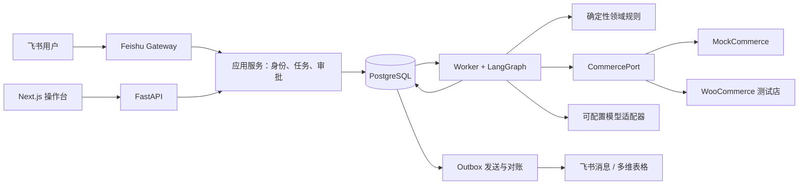

# 整体架构

状态：Phase 0 推荐设计，待评审。技术事实来源见 [调研记录](RESEARCH.md)。

## 1. 部署形态与技术选择

选择模块化单体、同一 Python 代码库的多个进程，而非微服务。FastAPI 管理请求与查询，Worker 运行 LangGraph 和发送队列，Feishu Gateway 管理长连接。开发时用 Docker Compose 编排 PostgreSQL、API、Worker、Gateway；Web 为按阶段启用的第五个容器。MockCommerce 起初是实现标准端口的进程内确定性适配器，故障测试用 HTTP 替身即可，不再单独部署模拟电商服务。



| 组件 | 选择与理由 | 约束 |
|---|---|---|
| Python | 3.12；本机具备 3.12.13 | 项目虚拟环境，uv 锁依赖 |
| HTTP / 契约 | FastAPI + Pydantic v2 | 入口只做校验与持久化，不运行长业务 |
| 工作流 | LangGraph 1.x + 官方 PostgreSQL checkpointer | 只用开源库；不依赖托管 Agent Server / LangSmith |
| 关系数据 | PostgreSQL 17 系列候选 + psycopg 3、SQLAlchemy、Alembic | 不追逐 PG 最新主版本；镜像/依赖需 Phase 1 实测后固定 |
| 队列 | PG jobs + Worker；Outbox 也是 PG 表 | at-least-once，必须承担租约、重试、恢复实现 |
| Web | Next.js + React + TypeScript | 只保留任务、报告、审批、轨迹四个核心视图；P0 中段再接入 |
| 飞书 | lark-oapi 官方底层 API/事件 SDK | 不引入额外通用 Bot/Channel 框架 |
| 电商 | MockCommerce → HTTPX Woo REST v3 适配器 | 核心领域不依赖 Woo JSON |
| RAG | P1 使用 pgvector、标准 SQL 检索与引用 | P0 不安装 embedding 模型和向量检索服务 |
| 测试 | pytest、真实 PG 集成测试、Playwright | 业务关键并发不用 SQLite 替代 PG |

Next.js 基线保留；如果 Web 开发显著拖延，可先交付 API 文档与飞书闭环，不能把自动化执行放进 Next.js Server Actions。Node 推荐项目容器使用 24 LTS，本机 Node 20 虽满足当前 Next 最低要求，但官方生命周期表已标记 EOL，不应成为新项目长期运行基线。没有更改全局 Node。依据：[Next 安装要求](https://nextjs.org/docs/app/getting-started/installation)、[Node 版本表](https://nodejs.org/en/about/previous-releases)。

FastAPI `BackgroundTasks` 适用于请求后小任务，不能满足本项目跨进程持久任务需求。PG 的 `SKIP LOCKED` 适用于队列消费者，不能用于取得一致的销量快照。参考 [FastAPI](https://fastapi.tiangolo.com/tutorial/background-tasks/) 与 [PostgreSQL SELECT](https://www.postgresql.org/docs/current/sql-select.html)。

## 2. 模块边界与目录规划

以下为未来目录规划，本轮不生成业务目录：

```text
backend/src/commerceops/
  domain/             # 值对象、库存规则、权限规则、状态机；无网络、无框架
  application/        # 创建任务、批准计划、创建补货、对账；定义 ports
  workflows/          # LangGraph 编排；调用 application，不直接发外部写请求
  tools/              # Pydantic I/O、工具元数据、调用审计包装
  adapters/           # commerce/mock、woocommerce、feishu、llm
  infrastructure/     # PG repositories、queue、outbox、checkpoint、observability
  entrypoints/        # API、worker、feishu_gateway
backend/migrations/   # 业务 Alembic；checkpointer 独立初始化
frontend/             # Next.js；只通过 API
skills/               # 版本化业务 SOP；不是可执行的外部脚本
tests/                # unit、integration、contract、e2e、eval
fixtures/             # 明确标识的固定模拟数据，后续创建
```

依赖方向：entrypoints/workflows → application → domain；adapters/infrastructure 实现 application 定义的 ports；启动层注入实现。domain 不导入 LangGraph、飞书 SDK、HTTPX 或数据库模型。Tool 包装用例，不复制用例中的权限逻辑。

## 3. 持久化责任

PostgreSQL 内分为业务表和 checkpointer 管理表（推荐独立 schema）。业务表决定“谁批准了什么、创建了哪些补货项”，checkpoint 决定“图到哪里”。不得把二者误称为自动同一事务。

- 入站 inbox、任务及首个 job 同事务提交，提交后 ACK。
- 计划版本、审批请求及待发送 outbox 同事务提交；审批卡片仅在 graph 中断已可恢复后发送。
- 审批决定和 resume job 同事务提交。
- 内部补货、执行回执、业务状态和 outbox 同事务提交。
- 网络发送发生在事务外；响应持久化失败由稳定幂等键和对账修复。

图节点重放时先按业务逻辑键读取已提交结果。图落后于业务表可以重放收敛；不能为了让图“看起来一致”删除已提交补货。

## 4. 队列与并发

jobs 至少包含 kind、task_id、dedupe_key、status、attempts、available_at、lease_until、lease_owner、lease_epoch。通过短事务 `FOR UPDATE SKIP LOCKED` 领取，提交后才执行网络/模型调用。初始租约 60 秒、每 15 秒心跳，参数可调；续租和完成操作必须匹配 owner+epoch。重试沿用同一逻辑键，只增加 attempt。

P0 默认一个 Worker，最多 2 个读分析并发。每个 graph thread 的整次调用还需独占的 PostgreSQL session advisory lock（独立连接持有，绝不使用连接池的随意归还连接），避免同一任务的 analyze/resume/recover jobs 同时操作 checkpoint。过期租约不等于锁已释放；回收者拿不到锁不得接管。

若持锁连接失效，立即取消本次运行；所有业务写再次检查租约 epoch。官方 checkpointer 不原生提供本项目的 fencing，不能声称仅加 epoch 就解决 checkpoint 竞争。P0 对无法证实旧运行终止的线程进入 `needs_attention`，停止旧 Worker 后才恢复；不热启动多个同线程写者。Phase 1 需用双 Worker 和进程终止试验验证该边界。

Outbox 按目标表/消息串行发送。Bitable 同一 table_id 只允许一个发送者；任务内的投影版本递增，旧版本不得覆盖新状态。小规模轮询足够，暂不用 LISTEN/NOTIFY、Redis、Kafka、Celery、Temporal。

## 5. API 与错误合同

规划端点：`POST /tasks`（客户端请求键、返回 202/task_id），`GET /tasks/{id}`，`GET /tasks/{id}/report`，`GET /tasks/{id}/events`，`POST /approvals/{id}/decision`，`POST /tasks/{id}/retry`（仅允许恢复操作），`GET /health/live` 与 `/health/ready`。飞书 HTTP 回调仅作必要时的备选入口，不预先部署公网服务。

统一错误：`code, safe_message, retryable, task_id?, trace_id, details`。常见类别包括 `UNAUTHORIZED_ACTOR`、`APPROVAL_EXPIRED`、`PLAN_CHANGED`、`DATA_INCOMPLETE`、`UPSTREAM_TIMEOUT`、`RATE_LIMITED`、`UNKNOWN_EXTERNAL_RESULT`、`BUDGET_EXCEEDED`。4xx 校验/授权错误不通过重试掩盖；未知外部写结果是单独状态，不归类为普通超时。

API 禁止接受客户端传来的 trusted actor/role/approved=true 作为授权。Web 第一版使用少量预置账号的服务端会话（密码哈希、HttpOnly/SameSite Cookie、CSRF 防护、允许源列表），会话映射到同一 principal；不在浏览器存平台密钥。开发身份替身只在显式 test 模式启用并醒目标识，不能用于真实审批验收。飞书 OAuth 登录延后，不成为 P0 前置条件。

## 6. 可观测、安全与运行

JSON 日志用标准 logging 即可；统一 task_id、trace_id、job_id、tool_call_id、external_request_id。业务审计写 PG，应用角色禁止普通审计更新/删除；不声称能防数据库管理员篡改。日志不保存密钥、完整回调 token、订单客户姓名/地址或模型原始隐私输入。

每个模型调用记录 provider、model、prompt_version、输入/输出 Token、可得的 cache Token、耗时和 pricing_version；费用仅为配置单价的估算。未知 usage/cost 写 null，不能写 0。P0 每任务模型调用目标≤3 次（意图一次、说明一次、至多一次结构修复），重试也计费计预算；设总超时/步数/Token 上限，超限出明确状态。

外部读取建议 connect 3 秒、read 15 秒；模型总调用预算 45 秒；均为项目初值，不是平台规定。安全重试最大 3 次指数退避加随机抖动，尊重 Retry-After。只能由一层协调重试，关闭或计入 SDK 内建重试，避免指数放大。持久延期释放 Worker，不在事务中 sleep。

开发 Compose 使用持久卷、健康检查和一次性 migration/setup 任务；数据库不默认暴露公网；配置由 `.env`/secret 文件注入，仓库只提交占位模板。运行时数据不进 Git；备份/恢复文档与演练在 P0 验收阶段完成。外部 HTTPS 校验证书，不为了本地便利关闭 TLS 验证。

## 7. 明确简化

暂不引入向量库服务、独立调度服务、多 Agent 平台、MCP、通用 Skill 执行器、Kubernetes、全链路可观测平台。P1 定时器沿用 PG jobs，`(schedule_id, due_at)` 唯一键；本地关机不能按时发日报，恢复后按“每个计划最多补最近一期”策略并明确迟到。外部要求全天运行时再讨论部署。
