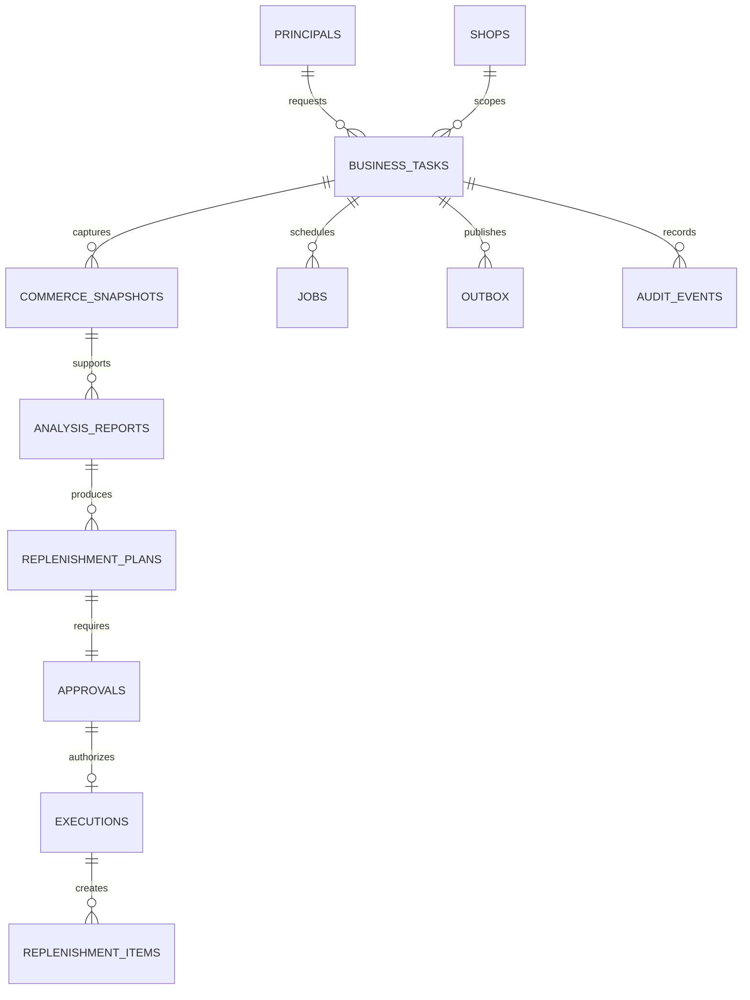

# 核心数据模型与事务

状态：设计稿，未创建数据库或 migration。表设计以 P0 为界，P1 实体单独列出。

## 1. 全局约定

业务主键使用 UUID；平台标识使用 text，避免误转整型。时间采用 `timestamptz`/UTC 存储，另存店铺 IANA timezone 供日界线换算。金额使用 `numeric(20,6)` + ISO currency，Python Decimal，JSON 用十进制字符串；展示按币种精度量化，禁止 float 金额与跨币种直接相加。

P0 件数为整数，不接受 bool 或小数件数。库存可为负；未知为 null 且必须附 reason。未来支持称重商品需升级契约，不隐式取整。输入与输出都有 `schema_version`。业务表关联使用 FK，删除任务不级联删除审批/审计；第一版不提供业务历史删除入口。

单组织不等于省略隔离：所有任务/快照均有 organization_id、shop_id；服务端从身份上下文取得这些值，不让模型指定租户。应用事务校验关联行的同组织同店铺关系，关键复合 FK/唯一约束在 migration 中落实。

## 2. 实体字段

以下省略各表通用的 id、created_at、updated_at；标注 immutable 的记录仅允许新增版本。

| 实体 | 主要字段 | 约束 / 索引 |
|---|---|---|
| organizations | name, feishu_tenant_key, feishu_app_id | 单组织配置；tenant/app 唯一 |
| shops | organization_id, adapter_kind, external_shop_key, timezone, currency, config_ref, environment | environment=mock/test；密钥只存配置引用 |
| principals | organization_id, display_name, enabled, roles, auth_version | roles 白名单；改权限递增 auth_version |
| identities | principal_id, provider, app_id, tenant_key, external_subject | `(provider,app_id,tenant_key,external_subject)` 唯一；飞书 subject=open_id |
| conversations | organization_id, channel, chat_id, actor_id, topic_key, summary, summary_version | 上下文按 actor/话题隔离；summary 不存授权 |
| conversation_messages | conversation_id, source_message_id, role, redacted_content, task_id | 入站消息唯一；限制历史长度 |
| inbox_events | source, app_id, tenant_key, event_id, message_id?, payload_hash, sanitized_payload, received_at, status, task_id? | `(source,app_id,tenant_key,event_id)` 唯一；消息事件另对 message_id 去重 |
| business_tasks | organization_id, shop_id, conversation_id, requester_id, kind, normalized_request, state, version, active_plan_id?, workflow_version, thread_id, failure_code? | thread_id 唯一且稳定；按 state/updated_at 索引 |
| jobs | task_id, kind, dedupe_key, payload_ref, status, attempts, available_at, lease_owner?, lease_until?, last_error? | dedupe_key 唯一；ready 可领取部分索引；单 Worker 基线，不提前引入 fencing epoch |
| commerce_snapshots | task_id, source_kind, fixture_version?, window_start/end, collected_at, collection_started_at, complete, quality_flags, source_watermark?, content_hash | immutable；source_kind=mock/woocommerce_test；完整性显式保存 |
| snapshot_products | snapshot_id, product_key, sku_key, sku_label?, title, stock_pool_key, manage_stock, available_stock?, stock_semantics, inventory_observed_at, raw_status, inbound_units?, inbound_quality | `(snapshot_id,sku_key)` 唯一；父商品与变体区分 |
| snapshot_order_lines | snapshot_id, external_order_id, external_line_id, sku_key, status, created_at_source, paid_at?, quantity, line_net, line_tax, currency | `(snapshot_id,external_order_id,external_line_id)` 唯一 |
| snapshot_refunds | snapshot_id, external_refund_id, external_order_id, occurred_at, amount, currency, lines_json, quantity_known, restock_known | 同 snapshot/refund 唯一；金额退款不能推出数量或回库 |
| analysis_reports | task_id, snapshot_id, rule_version, parameters, metrics_json, findings_json, narrative, narrative_mode, prompt_version?, facts_hash | immutable；统计与 LLM 叙述分离 |
| replenishment_plans | task_id, report_id, version, status, canonical_items, required_assumptions, plan_hash, rule_version, expires_at | immutable 内容；`(task_id,version)` 唯一；task 指向当前有效版本 |
| approvals | task_id, plan_id, plan_version, plan_hash, status, eligible_principal_ids, nonce_hash, expires_at, ready_at?, decision?, decision_action?, decision_payload_hash?, acknowledged_assumption_keys, decided_by?, decided_at?, decision_event_id?, decision_source?, consumed_at? | plan_id 唯一；pending 只能转换一次；决定/确认字段同事务保存且不允许事后修改 |
| executions | task_id, plan_id, approval_id, operation_key, request_hash, revalidation_snapshot_id, status, result_refs, started_at, completed_at?, error_code? | operation_key 唯一；审批与计划关联一致 |
| replenishment_items | execution_id, shop_id, sku_key, stock_pool_key, quantity, status, version, source_snapshot_id, approved_plan_id, approved_by, resolved_by?, resolved_at?, resolution_reason?, resolution_request_key?, resolution_payload_hash? | quantity>0；`(execution_id,sku_key)` 唯一；每店铺 stock_pool 仅一个 open 项；关闭请求键按 actor+endpoint 作用域唯一 |
| outbox | task_id, destination, aggregate_id, aggregate_version, operation, dedupe_key, request_hash, payload_ref, provider_idempotency_key, status, attempts, next_attempt_at, lease_fields, external_id?, last_error? | dedupe_key 唯一；同目标串行；写入前持久化 provider key |
| external_links | destination, local_entity_id, external_id, remote_version?, last_synced_version | `(destination,local_entity_id)` 唯一；反向 external_id 唯一 |
| tool_calls | task_id, run_attempt, node, tool_name/version, args_hash, safe_args, result_ref?, status, duration_ms, external_request_id?, error_code? | 记录每次尝试；与业务幂等回执分开 |
| model_calls | task_id, call_id, provider/model, prompt_version, status, input/output/cache_tokens?, duration_ms, cost_estimate?, pricing_version? | null 表示未知；失败也记录 |
| audit_events | organization_id, task_id?, actor_id?, source, action, entity_type/id, before_state?, after_state?, reason?, trace_id, occurred_at | append-only 应用权限；不存未经脱敏原文 |

完整商品/订单同步仓库会过度设计；P0 使用任务级冻结快照及少量标准化子表，避免先建设通用数据仓库。snapshot 子表是本次分析证据，不被后续抓取覆盖。

checkpointer 表由 `langgraph-checkpoint-postgres` 管理；不手写其内部列，不用业务 ORM 映射这些表。业务 `thread_id = task UUID`，一个会话可关联多个 thread；群 chat_id 不能直接成为 graph thread_id。

`required_assumptions` 为不可变对象列表，每项包含 `key=inbound_unknown_zero:{sku_key}`、type、sku_key、estimated_units=0、disclosure_version。canonical_items 保留 raw inbound_units=null 与 effective_inbound_units=0 的区别。确认只表示接受估算假设，不能更新来源快照为“已知零”。`acknowledged_assumption_keys` 是 T3 从已校验请求保存的精确键集合，不是 LLM 或客户端提供的已授权布尔值。

## 3. 状态机

business_tasks：`queued → analyzing → awaiting_approval → executing → completed`。分析无建议可直接 completed（outcome=no_action）；拒绝为 rejected，超时为 expired；数据/权限变化为 needs_reapproval；失败为 failed 或 needs_attention。同步状态不混入主状态，单独汇总 `pending/synced/failed/unknown`，例如 completed + sync_failed 表示内部任务已创建。

approvals：`pending → approved | rejected | expired | superseded`；不允许 terminal→pending。approved 表示已经做出的决定，事后计划失效通过 plan.status 与 execution 拒绝表达，不能篡改历史决定。consumed_at 在内部补货事务提交时写入。

replenishment_items：仅 `open → completed | closed`，两种终态都释放 open 唯一约束；completed 指内部跟进完成，closed 指取消/无需继续，均不代表库存到货。P0 不实现 in_progress、重新打开或批量关闭。此生命周期与原 business_task 的分析执行终态分开。

jobs：`ready → running → done | retry_wait | dead`。outbox：`blocked → pending → sending → sent | retry_wait | unknown | dead`；blocked 只用于等待审批中断持久化的卡片意图，其他投影可直接 pending。未知写入结果需对账，不把 unknown 自动改回 pending。

## 4. 事务边界

| 事务 | 原子写入 | 事务外行为 / 崩溃恢复 |
|---|---|---|
| T1 入站 | inbox + task + analyze job + audit | 提交后 ACK；冲突返回原任务；DB 不可用不 ACK 成功 |
| T2 生成计划 | immutable plan + pending approval + blocked card outbox | graph 中断 checkpoint 落盘后设置 ready_at 并放开发送；扫描器可修复 |
| T3 决定及假设确认 | 锁 task/plan/approval/principal，校验版本/hash/action/精确确认键集合，pending 条件更新决定及确认记录 + resume job + audit | 一次显式动作；没有独立的可复用确认阶段；普通批准漏确认仍 pending |
| T4 内部执行 | 校验当前授权、Worker 所有权及已落库确认，锁计划/审批，写 execution + 全部补货项 + consumed_at + task completed + outbox + audit | 单事务全有或全无；提交后图失败由 operation_key 返回原结果 |
| T5 外部回执 | outbox sent + external_link + sync audit | 网络调用不在本事务中；回执丢失按外部幂等能力对账 |
| T6 完成/关闭工作项 | 依次锁 principal、item，校验角色/店铺/request_key/expected_version，以 open 条件更新终态、原因、操作者、版本 + audit + outbox | 由显式 Web/API 操作触发，不经过 LLM；提交后响应丢失返回原关闭回执 |

T3/T4 锁顺序统一为 task→plan→approval→principal→stock_pool（排序），使用 DB 时钟检查 expires_at。权限变更也锁 principal，防止检查后角色撤销穿透事务。external snapshot 的读取不能与 Woo 原子锁定，因此只承诺“基于执行前最新一次观测创建内部工作项”，不承诺锁定真实库存。

T4 先检查是否已有 operation_key；存在且 request_hash 相同则返回回执，不再次写入；同 key 不同 hash 为冲突。补货项唯一约束挡住同一计划重放；`(shop_id,stock_pool_key) WHERE status = 'open'` 的部分唯一索引挡住不同任务对同一库存池的重复安排。发生冲突时全计划拒绝创建，提示重算/核对，不悄悄部分执行。

T3 对未知在途只允许 `approve_with_assumptions` 携带与 required_assumptions 完全一致的确认键集合；`reject_assumptions` 不要求确认键，保存拒绝原因 `INBOUND_ASSUMPTION_DECLINED`。漏确认返回 `ASSUMPTION_ACK_REQUIRED`，不创建 resume job。已认证且有查看权的原操作者重复同版本、同 action、同决定 payload 返回既有回执（不重新做一次批准）；其他操作者或不同决定 payload 返回已决定/冲突。拒绝/重复行为详见 [PRD 4.1](PRD.md#41-在途未知的显式确认合同)。确认与决定不分两个事务，不跨计划版本继承。

T6 仅同店铺当前 approver 可调用，原因不能为空。保存 `resolution_request_key` 和语义 payload hash（item_id、action、reason、expected_version）；相同 actor/key/hash 重试返回原结果，不重复增加审计/投影版本；相同 key 不同 payload 或新请求修改终态返回冲突。下一周期采用新任务、快照、计划及审批，旧 execution 幂等键始终保留，关闭不能绕过历史执行去重。T6 锁顺序为 principal→item，不再回头锁 task/plan/approval；权限变更仅锁 principal，避免形成锁环。

## 5. 幂等键与计划绑定

- 消息入口：平台 event_id 去重，message_id 再防同一消息不同投递；Web 客户端 request_id 按 principal+endpoint 作用域唯一。
- 审批：approval_id+plan_hash，平台 event_id 是投递去重；“按钮灰了”不是并发控制。
- 假设确认：与审批决定共享 plan_id/version/hash、actor 与 decision_payload_hash；无全局“已确认未知在途”标志。payload hash 覆盖 action 和规范排序的确认键集合，不含可变化的投递 event_id。
- 内部执行：`restock:{shop_id}:{plan_id}:{version}`；每条 SKU 有唯一行约束。
- 内部关闭：principal+endpoint+request_key 唯一，绑定 item_id 与原始语义 payload；重试不关闭下一周期的新 item。
- 同步：`bitable:{replenishment_item_id}:{projection_version}`；创建时随机 UUIDv4 client_token 持久化后复用。
- 消息：每个逻辑发送 outbox 固定 UUID，飞书发送去重窗口外不可认为仍受保护。

plan_hash 基于 canonical JSON：shop、币种、排序后的 SKU/库存池/数量、规则参数与版本、关键库存/需求事实、数据质量、完整 required_assumptions（含说明版本）及有效期。用户确认记录不反过来修改 plan_hash。生成 hash 时明确定义 Decimal 字符串和空值序列化。报告修辞不进入授权 hash；不得把 LLM 描述当作执行参数。

## 6. 保留策略与 P1 扩展

初始建议：脱敏事件及工具输入摘要 30 天，报告/快照/checkpoint 90 天，业务审批/执行/审计 180 天；未结束任务及其引用数据不自动清理。保留期为开发默认建议，生产使用前与用户确认。日志/备份同样脱敏和限制访问。

P1 再新增 schedules、report_deliveries、knowledge_documents/chunks、copy_drafts；向量维度、embedding_model/version 与 chunk_version 必须绑定，换模型不能混用原向量。SOP 和草稿记录审批与引用来源，不扩张为通用内容管理平台。
