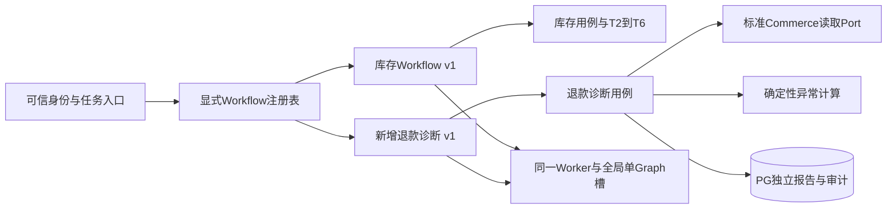

# CommerceOpsAgent 业务扩展架构规范

更新日期：2026-10-10（Asia/Shanghai）。性质：**待审核的设计补充，未实现、未进行扩展运行验证**。配套 [30 天执行计划](30_DAY_EXECUTION.md)。本文件在既有 [ARCHITECTURE](../ARCHITECTURE.md)、[DATA_MODEL](../DATA_MODEL.md)、[AGENT_DESIGN](../AGENT_DESIGN.md)、[PRD](../PRD.md) 上约束未来增量开发，不替代已收口Phase1合同或授予Phase2编码权。

源码/状态基线：main `f8ed1800e1c82802e5d3c3f6c5a4a2d76050a5a0`，PR #19/#22/#25/#27/#28均已合，P1必要G1/G2/G3经有限技术合同验收，精确main CI37965530018成功（345offline/79真实PG、三G1/六G2/cleanup0）。既有intake/runner/queue/Worker/lock/checkpoint、Feishu技术probe和公开harness已在main；统一业务CommercePort、Workflow注册表、业务Tool执行器与下列业务子包仍待授权实施，不描述成可用框架。本规划普通merge基线6d5b253，parents44b457c/f8，无冲突；相对main只改两规划文件，不自行改业务/锁/环境。既有总控为全项目唯一总控，规划/UX继续原独立顶层，Phase2以后编码须新授权并另开独立顶层Worktree；本轮只准备合同与排期。

P1技术Gate不代表正式库存/订单/模型闭环或M1完成：G3为真实接入、技术决定、重复/冲突/过期/DB失败、受控重启和Base有限观察；non@/self-bot按平台最小权限非投递边界，后端filter分支仍not_run；自然网络故障/wire/p95/长期幂等TTL/特定Base retry等未验证。原Baseunknown与403/1254608观察保留，不改为成功ACK。#23已CLOSED且risk_accepted/root_cause=not_identified，不虚构配置根因、不续开调查。正式T2–T6、A/C/R和产品卡片能力由后续阶段实测。最新Issue/PR/UX候选及边界见配套计划第1节，原阶段验收事实原样保留。

## 1. 扩展目标与保留基线

目标：新增一种业务功能时，主要新增该功能的领域计算、用例、Workflow/Tool定义、适配实现和页面；在启动组合处显式注册，按需要追加迁移与权限映射。已有库存规则、版本审批、执行幂等和恢复不应因新功能大规模改写。允许少量显式注册/路由/枚举/迁移改动，**不承诺零修改，也不声称当前已经证明此性质**。

必须保留：模块化单体、同一Python代码库；PostgreSQL业务权威状态；FastAPI/Gateway接收入站并落库；PG jobs/outbox；单Worker、全局单Graph执行槽、无图内并行/并行Tool；checkpoint与业务事务分离；网络调用在短事务之外；可靠停止后才能恢复。多个业务Workflow定义共用同一个串行执行入口，不意味着新增并发执行槽。

不为“可扩展”引入微服务、第二调度器、Redis/Kafka/Celery/Temporal、外部向量库、Kubernetes、通用多Agent平台、任意Skill脚本运行器或MCP。RAG在Phase6按原计划使用PostgreSQL/pgvector，扩展安装仍需授权与迁移负责人。多Worker/fencing属于C-EXT，必须以吞吐证据、用户新授权和R02–R04专项评审启动。

LLM仅做意图、参数澄清、解释和受限选择。金额、统计、库存、权限、审批、幂等、预算与状态转换由确定性代码执行。新功能的业务价值不得以“让模型自己想办法完成”代替领域契约。

## 2. 按层保留边界，层内按业务组织

延续P1已建立的目录，不在30天内做目录大迁移；新模块在各层内部建业务子包，避免所有功能塞进同一个`agent.py`或全局`services.py`。以下均为建议路径，不是本轮新增代码：

```text
backend/src/commerceops/
  domain/
    inventory/              # 风险纯函数、值对象、库存规则版本
    reporting/              # 日报金额/订单/退款/异常计算
    content/                # 引用和草稿业务规则
    shared/                 # 少量稳定值类型；禁止积累业务分支
  application/
    ports/                  # 类型化协议，不依赖具体SDK/PG
    inventory/              # 计划、审批、复核、内部项用例
    reporting/              # 日报、追问、只读查询用例
    content/                # 检索、候选、审核草稿用例
  workflows/
    registry.py             # 只读显式定义/版本注册
    inventory/              # 既有固定库存Graph
    reporting/              # 日报/受限只读Graph
    content/                # 文案Graph
  tools/                    # ToolSpec/白名单执行包装；业务模块分组
  adapters/
    commerce/mock/          # 标准契约实现
    commerce/woocommerce/   # Woo JSON语义转换
    feishu/                 # 渠道/投影，不含库存计算
    llm/                    # provider能力/usage标准化
  infrastructure/           # repositories/UoW/queue/outbox/checkpoint
  entrypoints/              # API/Worker/Gateway、依赖注入/显式注册
backend/migrations/         # 单一Alembic revision链，主控协调
frontend/
  features/                 # tasks/inventory/approvals/reporting/content
  components/               # shell/事实表/状态/表单/轨迹等共用语义组件
  lib/                      # typed API client、显示格式与受控缓存
```

| 边界 | 允许依赖/职责 | 禁止事项 | 扩展审查问题 |
|---|---|---|---|
| domain | Python值对象、Decimal/日期、纯函数与明确状态规则 | SDK、HTTP、ORM、LangGraph、环境密钥、LLM权限判断 | 同输入是否能独立复算？未知与零是否分开？ |
| application | 调用domain与抽象Port；身份校验、事务用例、预算/幂等合同 | 直接解析Woo JSON、直接发飞书请求、用checkpoint代替审批 | 所有入口是否复用同一用例/授权与回执？ |
| workflows | 版本固定的编排、节点引用、interrupt/resume；调用用例/Tool | 直接SQL写业务表、网络写副作用、根据模型approved授权 | 节点重放是否只消费持久回执？ |
| tools | 类型I/O、effect白名单、审计脱敏、超时/预算包装 | 复制授权/计算逻辑、任意SQL/URL/shell、模型自由写权限 | wrapper是否仍调用同一用例？ |
| adapters | 端口实现、外部语义归一、能力/错误/分页/重试限制 | 源字段混入核心、静默能力降级、擅自扩大scope | 换平台是否只影响此层与配置？ |
| infrastructure | PG持久、约束、事务、jobs/outbox/恢复与checkpoint技术实现 | 把业务真值藏在发送cache、修改checkpoint内部表 | 唯一键/停止证明/恢复是否延续旧合同？ |
| entrypoints | 认证、schema、安全错误、202/读响应、组合注入 | API/Gateway直接运行Graph、信客户端role、Next长业务 | 入站是否提交后ACK、按可信context绑定scope？ |
| frontend | API DTO呈现、本地草稿、导航、焦点/可访问性 | 计算权威数量/金额/资格、平台密钥、模拟权限冒充真实 | 刷新/撤权/unknown能否收敛于服务端事实？ |

不同业务模块通过用例/Port与版本化引用交互，不直接操作对方repository/table。`shared`只收经两个模块验证的稳定通用类型；不预先抽象通用审批平台/报表平台。可复用技术事务与回执包装，但库存plan/hash/未知在途规则仍归inventory。内容审核不得复用库存approval ID或假设确认记录来授权保存草稿。

## 3. Port / Adapter 契约

Port定义在application，以窄协议/类型DTO表达业务需要；启动层注入Adapter，测试用同一Port的确定性替身。实现时可用Protocol/ABC，选择保持简单，不引入动态服务发现/插件宿主。构造依赖显式传入，领域不查全局容器。

| Port职责（拟定） | 必需输入/输出合同 | Adapter/约束 |
|---|---|---|
| Commerce读取 | 服务端scope、窗口、SKU与容量；商品/订单/退款/库存标准DTO；source/as_of/完整性/分页与quality | Mock/Woo同一契约；Woo只读；未知stock/inbound为null+reason；退款金额不能换件数或假定回库 |
| Snapshot/Report持久 | immutable版本、content/facts hash、来源/规则引用、读取scope | PG repository；不由后续抓取覆盖历史证据 |
| UnitOfWork/业务回执 | 明确T1–T6用例边界、operation_key/request_hash、原子提交 | PG实现与关键唯一/CAS/FK约束；网络不在事务中；不暴露给模型 |
| Identity/Authorization | 可信principal/org/shop、对象/动作、当前auth_version与eligible | API会话/飞书可信映射；禁用/撤权重读；不从checkpoint恢复角色 |
| Job/Workflow运行 | 持久task/thread/version、kind、dedupe_key、可信worker_owner | 复用P1 runner/queue和全局单槽；新功能不另建后台循环 |
| Notification/Projection | outbox引用、目标允许范围、版本、持久provider key、能力 | 飞书发送/Base由同Worker串行；未知结果走对账，原键期限外不盲重发 |
| Model | 允许provider/model、prompt/schema版本、预算；结构化结果/usage/latency | provider能力显式声明；usage/cost未知为null；错误安全化；调用失败也计预算 |
| Knowledge | 允许文档集合/版本、查询上限、命中文档/chunk/embedding版本及引用 | PG/pgvector；检索文本是不可信数据；不足就说明，不执行Markdown脚本 |

现有标准读取失败返回`DATA_INCOMPLETE / UPSTREAM_TIMEOUT / RATE_LIMITED / UNSUPPORTED_CAPABILITY`等安全错误；明确不完整和空数据区别。适配器必须保留schema_version、币种Decimal字符串、IANA时区、UTC时点、来源标识、分页收集范围与容量上限；对不支持的新字段返回未知/拒绝，不虚构默认值。

新增电商平台步骤：列能力（商品/订单/退款/库存/变体/共享库存/分页/时区/只读权限）→确定该平台到标准DTO的字段/语义映射→固定合成/获授权脱敏样本→实现Adapter和契约测试→启动组合显式注册→指定测试店真读对账→审核合入。规则不读`adapter_kind == "new_platform"`来改变公式；能力缺失由DTO质量/资格约束阻止执行。需新增称重单位/成本/平台写操作时属于契约升级和新业务授权，不能假装是替换Adapter。

## 4. Workflow 注册与版本合同

注册表保持小型、显式、只读的源码配置，由组合根导入已审核实现。不从用户/模型文本加载Python、任意模块、URL或脚本；无运行时市场/插件安装。新增一种业务通常增加一个定义和一条启动注册，Agent路由消费注册信息，不改库存Graph节点。

每个WorkflowDefinition至少包括：

| 字段 | 约束 |
|---|---|
| workflow_id / workflow_version | 稳定命名与不可变版本；重复ID+version启动失败；task创建时绑定 |
| intent aliases / parameter_schema | 受支持意图和类型参数；模型选择仍经过程序白名单/参数验证，歧义澄清 |
| state_schema_version / factory | 独立状态schema、已审核构造函数；state只存引用/小摘要 |
| required_actions / object_scope | 服务端权限能力，明确读/写对象范围；不能传principal覆盖可信context |
| allowed_tool_versions / effects | 精确工具版本与effect集合；只读流程拒绝internal_write/external_projection |
| budgets | 步数、Tool/模型调用、Token、时间、行数/页数与费用；重试计预算 |
| result_kind / report_schema_version | 类型化领域结果；标准状态/出处封套、业务指标namespaced schema |
| resume_policy / supported_versions | 可恢复图版本与中断位置、退役策略；无法解释则needs_attention |
| acceptance_refs | 对应golden、故障、安全与真实平台Gate的索引 |

示意（伪代码，未实现）：

```text
composition root:
  register(inventory_replenishment@v1, inventory_factory, inventory_spec)
  register(daily_report@v1, daily_factory, report_spec)
  register(readonly_inquiry@v1, inquiry_factory, readonly_spec)

task intake:
  trusted context -> allowed registry entries -> typed intent/params
  -> application authorization -> persistent task+job -> ACK

single worker:
  claim through existing queue -> acquire existing global execution slot
  -> resolve task.workflow_id/version -> invoke selected definition serially
  -> keep business receipts and checkpoint separate -> safe release/stop
```

这里的task.workflow_id是拟定逻辑字段，P1当前业务kind/workflow_version的实际结构须由原主控在授权阶段选择映射：可以用已有限定kind映射到registry ID；如需要增加kind/字段/数据库约束，必须显式迁移。不得修改P1技术探针字段来偷渡业务注册。稳定版本的共用dispatcher一次建立后，新功能只能追加映射，不能再堆到全局`if/elif`并更改旧分支行为。

恢复读取任务创建时固定版本，不自动切到注册表的latest；未结束任务部署时排空或保留旧版本工厂。schema/interrupt位置变化新增版本，不能热改等待节点顺序；缺旧工厂、未知checkpoint/业务关系则needs_attention，展示已有业务事实，禁止删除checkpoint或从START重放写操作。checkpoint不存秘密、订单全集、nonce或可信role。

P0模型不能自由调写Tool；库存Graph固定编排。Phase6动态只读模型在精确白名单内逐次选工具，执行器再验effect、scope、参数与预算；只读用户提出写要求时结束/引导单独业务请求，不能自动转入库存批准流程。相同全局执行槽串行运行所有图定义，待审批checkpoint落盘释放槽，其余持久排队。

## 5. Tool 及副作用合同

ToolSpec沿用AGENT_DESIGN字段：name、version、description、input_schema、output_schema、required_role、effect、timeout、retry_policy、idempotency_policy、audit_redaction。扩展时再明确调用能力/action scope、结果出处、预算计数与可否被模型选择；这些声明不能代替application的运行校验。

统一结果封套：`ok / data / error{code,safe_message,retryable} / provenance{source,snapshot_id或report_id,as_of} / warnings`。业务数据在严格版本schema中，不能以任意JSON绕过校验。记录tool_call_id/name/version/args_hash、node/run_attempt、结果引用、状态/耗时/错误；请求摘要与结果均脱敏，不输出秘密/SQL/客户PII/模型思维链。

| effect | 可用位置 | 新Tool必须证明 |
|---|---|---|
| pure | 明确用例或Workflow节点；输入冻结事实 | 同输入金标一致，无网络/写入，金额Decimal与未知语义正确 |
| read | 固定Workflow或Phase6只读白名单 | scope由context限制、分页完整/容量/数据时点、安全失败/澄清、无隐藏写入 |
| internal_write | 已授权受控节点或显式业务API；不向动态模型暴露 | 可信身份/当前权限、版本绑定审批（需要时）、唯一幂等键+payload hash、PG原子回执/审计/outbox、正式故障测试 |
| external_projection | outbox handler；非Agent可选Tool | 已提交业务意图、允许目标、持久原provider key、版本顺序、时限/对账和unknown停止 |

单Tool超时不证明后台线程/进程已经结束，不能因此释放业务执行槽或启动恢复。新增同步工具需证明取消/停止边界；证明不了就needs_attention并人工处理。沿用P1单Worker停止合同，不把夜间诊断supervisor的退出当业务执行死亡证明。

副作用长期幂等由PG负责，外部平台去重期限有限。read可按协调层预算退避，write按该业务回执/平台能力决定安全重试；同键异payload冲突。429/5xx与外部写结果unknown分开，unknown禁止换键或自动重置pending。内部补货completed与sync_failed并存，外部故障不能回滚已提交业务。只由一层协调重试，SDK内建次数关闭或计入预算，不形成乘法重试。

库存批准不能被泛化为任意业务授权：必须保留plan_id/version/hash、精确假设键集合、nonce/期限、eligible/当前角色及执行前复核；未知在途只能显式联合确认，原始null不改零。文案审核另绑定draft candidate内容hash/引用版本/审核人与当前权限，库存approval不能授权发布或草稿写入。任何未来平台真实写入、支付/退款或真实采购都需要新的明确人工授权与独立合同。

## 6. 数据、迁移与部署兼容

PG是任务、报告、计划、决定、执行、草稿、审计的权威来源；UI缓存、Base投影和checkpoint均是引用或进度，不能决定业务是否成功。统计使用冻结证据/类型化读模型，不先建设通用数据仓库。

新业务实体归该模块，带org/shop（适用时）、版本、来源、状态与schema约束；共享business_tasks/jobs/audit/outbox只放稳定技术封套。日报指标/库存事实分别有类型schema，不能把全平台原JSON塞进共享payload然后让模型解释。追加引用或kind是正常小变更，避免影响库存计划hash和既有immutable记录。

| 迁移规则 | 可审要求 |
|---|---|
| 单一revision链/负责人 | 主控指定唯一迁移负责人，合并前基于最新已验证revision；并行模块先提交字段/约束提案，不能各自制造分叉head |
| 默认增量兼容 | 新表/字段/index、显式schema版本优先；破坏性删除/重解释字段另行评审；不覆盖immutable快照/已决定审批 |
| 关键约束在DB | org/shop关联FK、request/operation/dedupe唯一、pending CAS、active库存池唯一、追加审计权限；不只靠Python先查后写 |
| 金额与时间 | numeric/Decimal字符串、ISO currency、UTC timestamptz+店铺IANA时区；件数整数拒绝bool/小数，未知null+reason |
| 业务与checkpointer分离 | 业务Alembic独立；官方checkpointer setup由部署一次执行，不能手写/改其内部表或每请求setup |
| 兼容与回退 | 干净库升级、旧数据升级、重复部署、安全失败、备份还原/待审批任务；应用回退仍可读新数据才允许，降库可能失数据时禁止自动downgrade |
| 运行升级 | 只在自有环境验证；停止旧Worker并取得死亡证明，迁移/setup由特定角色，运行角色最小权限；禁止滚动重叠 |
| 保留与隐私 | 不自动清未结束任务引用；既有建议保留期需用户确认；秘密只存引用，不进快照/日志/备份清单/仓库 |

新schedule、report_delivery、knowledge/chunk与copy_draft属于原Phase6计划实体。schedule_id/due_at唯一、重启每个schedule最多补最近一期；所有执行仍进入PG jobs及同Worker，不能隐藏第二cron常驻进程。embedding_model/version、维度、chunk/source版本绑定，换embedding需显式重建并区分索引版本，不混用旧向量；不因此部署新向量服务。

运营风险概览是只读汇总，基于有权最新报告/审批/同步状态，返回as_of/完整性/覆盖范围；不得跨scope泄露计数，不将未采集SKU算成正常。初版按需SQL即可；只有测得慢查询且预算允许才评审索引/物化优化，不引入独立分析仓库。

## 7. 权限与扩展安全边界

每个新功能声明“谁可做何动作、对何对象、在哪个组织/店铺、在什么状态/版本下”，统一服务端策略函数与查询过滤；不用自由文本role、approved=true或隐藏按钮实现授权。入口取得可信principal，application当前校验，写事务内配合必要锁/版本复核；恢复时重读权限，旧checkpoint不能授权。

沿用C1最小权限：operator读本人有权任务及派生对象；approver读eligible审批及必要任务并管理同店铺内部项；admin单角色仅脱敏运维，不默认获得业务读/审批权；兼任取每个角色自身授权对象/动作的并集，不能拼接角色A的动作与角色B的scope。共同拒绝条件优先。新增功能如需要“读全店经营指标”须显式定义/授权，不沿用admin自动兜底，也不建设通用组织树/RBAC平台。

新增API/Tool/UI必须覆盖无权、跨组织/店铺、非eligible、页面打开后撤权、身份禁用、过期/陈旧版本、深链/计数/缓存泄露。Web沿用预置账号服务端会话、HttpOnly/SameSite/CSRF和允许源；平台密钥不进浏览器。Mock身份/模拟审批必须标识，真实平台验收不能使用开发替身。

商品描述、订单文本、SOP与用户请求均不可信；不能改变注册表、Tool白名单、provider URL允许列表、scope或批准范围。日志/工具轨迹只展示脱敏执行事实与结果引用，不保存原始隐私输入；无权对象与不存在对象使用相同安全反馈。

## 8. 前端页面与组件复用

现有UX方向为PR #24的C1 `0.2.1-c1-revision` 与完整候选 `m1-ui/0.4.1-freeze-rc` / revn58，冻结设计内容来源5a801faf；当前PR普通merge后head2550d4e，UX/tools设计子树与5a逐字不变，新headCI/独审状态见配套计划最新快照，不借旧CI覆盖f8上下文。18逻辑页、47语义控件（46可渲染、B09不渲染）、18组件/33Token已交接；B30/E30进入S08运维，B31/E31按当前有权身份返回首页，admin-only不默认读业务/审批。产品/视觉外审既有结论已通过，最终冻结确认与main合入仍待用户；BC01–07pending，全部业务not_implemented。后续不能机械复制Flex子对象顺序或把模拟点击/禁用proposal接为真实API；需相应合同与编码授权。

P2纸面/后续获授权的库存DTO与纯规则不以所有UX资产最终冻结为前置；相关字段/规则口径由总控协调确定。前端接入和正式卡片需相应BC、最终设计确认和实施授权，UX文件的“真实G3待验”是产品卡片/业务验收，不否认已完成的P1技术G3。设计修订只由原UX顶层处理，本会话不操作其资源，不重建组件库或提前通用平台。

每页保留稳定screen/control/event ID与设计版本，实施映射到路由、组件、API DTO和E2E情景；新增日报/SKU/草稿用新的namespaced ID，不改旧库存控件语义。tokens由获确认设计版本提取到受控本地文件，代码复用色彩/间距/字级/状态组件；不自动双向同步原设计资源、不整包复制旧项目。

| 共用组件/能力 | 复用内容 | 业务差异留在feature |
|---|---|---|
| AppShell/授权导航/深链 | 当前环境、店铺、角色、返回位置与会话失败 | 各模块只有有权路由；不由导航授予权限 |
| 任务标题/状态条 | business state、decision、sync三态分开、时间/来源 | 新Workflow结果类型；不复用库存“已创建”文案表示日报/草稿成功 |
| 事实表/SKU行/来源说明 | 数字右对齐、单位、长SKU、null/负值、as_of/quality/版本 | 列schema、计算已由后端提供；不在前端重算建议量/利润 |
| Disclosure/决定动作区 | 完整范围、当前版本/期限、提交中/unknown/冲突、禁止默认确认 | 库存假设动作与内容审核分别实现，不把通用ApproveButton当授权 |
| 原因表单/对话框 | 原因验证、焦点约束/返回、键盘/Esc、request_key保留 | 完成/关闭、草稿审核等payload合同独立；不共享业务幂等键 |
| Timeline/用量 | tool/model/approval/receipt/outbox事实引用，null费用/Token | 业务节点/结果，禁止显示思维链或原始秘密 |
| typed client/缓存 | 统一safe error、会话/CSRF、取消读取、loading/empty/failure | query key带identity/scope/task/version/source；新feature DTO版本独立 |

mutation不乐观宣称成功；结果unknown时读原对象/回执，必要安全重投沿用原key/payload，不能自动选相反动作。登录切换/撤权清空旧敏感缓存，查询计数同scope。报告筛选不会改变批准范围；审批≤20条仍必须完整披露，390宽动作位于全清单后，无悬浮快捷批准；普通重读不产生副作用。C1 B09通用手动恢复仍不渲染、不绑定。

新页面是同一Next.js应用的feature路由，通过API读写，不用Server Actions执行长Graph/平台写操作。保留中文优先、1440/1280/390布局、焦点/读屏、正文/非文本对比与44px触控目标；设计原型点击、Playwright业务、真实飞书客户端分别计证据，缩放固定画布不叫响应式通过。

## 9. 扩展测试与交付门槛

每个新业务附需求→契约→测试→PR→main的追踪；测试验证不变量，不用复刻实现/覆盖率替代验收。必须实际执行才记passed；blocked/not_run/skipped/失败和技术probe清楚区分。

| 测试层 | 新功能最低要求 | 保留的旧核心回归 |
|---|---|---|
| domain金标 | Decimal/币种/时区/null/边界/数据不足，无LLM算数 | 原库存D/T/Q、风险/资格/未知在途和退款独立 |
| Adapter contract | 每实现同标准DTO/分页/限额/错误/能力；fixture明确Mock | Mock/Woo同契约、库存池质量不被新平台绕过 |
| 应用/真实PG | scope/FK/CAS/唯一键、事务回执、审计/拒绝/重复 | T1–T6、active stock_pool、同key异payload、撤权锁顺序 |
| Workflow/恢复 | 新定义版本固定、单槽、interrupt边界、业务提交后checkpoint前故障、退役/未知版本停止（按实际effect适用） | 原库存待审批跨进程恢复、过早决定、停止证明、旧execution不新建 |
| Agent安全与评测 | 注册白名单、参数澄清、预算、注入、引用与真实provider证据 | 40冻结用例、三轮/holdout、D01–D05、不出现库存写Tool旁路 |
| UI/E2E | stable ID/typed DTO、授权/撤权、unknown/冲突、键盘/窄屏 | 全SKU批准范围、原因必填、三态、无手动恢复 |
| 真实平台 | 新Adapter/通知在指定资源实测和对账 | 飞书真人审批/Base、Woo真只读与备份还原；替身不能抵用 |
| 质量/敏感 | 冻结锁、lint/typecheck/build（适用时）、文档链接、当前/index/可达历史敏感检查 | CI失败不能合入；共享依赖锁/迁移只由协调负责人提交 |

新feature的只读变化只运行适当读取/契约与核心回归；涉及共享queue/迁移/身份/registry/状态机时增加真实PG/恢复集。纯文案/token小改不制造重复的镜像测试；影响批准披露/焦点的UI必须验实际交互。R02–R04多Worker测试仍后置，不因注册多个Workflow提前引入并发架构。

交付必须冻结base/head、依赖/镜像/迁移与schema版本、测试命令/时间/结果、mode标签、真实资源授权与脱敏证据、风险/未验证项。独立审核看同SHA；用户确认合入、主控核对精确CI/Gate及main后才正式完成。新平台运行授权、下一Phase授权和公开部署不由PR创建推导。

## 10. 新业务扩展的设计证明与后续验证

代表性新增业务：**“售后退款异常只读诊断”**。用户问“最近七天哪些SKU退款比例异常，依据是什么？”；程序按已定义的件数/金额口径与质量计算，模型解释证据，输出独立报告。它不执行退款、不支付、不改订单/库存、不自动创建补货项。金额退款与件数不混推，缺退款件数标未知；阈值/分母/时间归属需要明确规则版本。

这是未来扩展例子，不加入本轮30天核心或启动实现。使用P0已有read_refunds的固定Workflow能力；若要进入Phase6动态只读集合，现有集合没有read_refunds，必须单独审核扩展白名单/预算与D安全集，不能在此例里自动扩大。



图表示定义及依赖，两个Workflow不能同时占槽。只读诊断无库存审批中断，不修改库存interrupt位置；新的报告可以使用自己的result_kind而非伪装为replenishment plan。

| 修改对象 | 预期变化 | 为什么不扩散到库存核心 |
|---|---|---|
| domain/reporting/refund_anomaly | 新纯函数/阈值版本/金标 | 输入标准订单/退款DTO，原inventory规则不引用此模块 |
| application/reporting | 新采集/冻结/报告用例，复用Commerce与Report/Authorization Port | 查询scope/数据完整性同一策略；不调用T3/T4/T6、不生成库存approval |
| workflows/reporting/refund_anomaly | 新状态schema/Graph定义/测试 | registry按task绑定版本选择，与inventory定义独立 |
| tools/reporting | 只读/pure包装及审计规范 | 新工具不进入旧动态白名单，无隐藏写Tool |
| adapters | 若现有标准退款字段足够则零改；不够则版本化DTO与Adapter映射/契约测试 | 不在库存节点加平台/业务条件；字段升级须回归旧读者 |
| infrastructure/migration | 独立报告schema/kind所需增量迁移、索引、受限权限 | 单一负责人；不改旧计划hash/审批决定/执行回执，不改官方checkpoint表 |
| entrypoints/composition | 显式追加一条注册、受支持intent、必要路由/kind映射 | registry/参数校验通用入口稳定，禁止改全局Agent提示为“自行退款” |
| frontend/features | 新报告页/导航元数据、复用事实表/来源/状态/轨迹 | 旧审批/工作项路由与事件ID不变，授权scope仍由API决定 |
| inventory规则/Graph/审批/恢复/Worker核心 | **预期零行为修改** | 唯一运行共享资源是现有串行槽/PG队列；新增定义不重写执行生命周期 |

设计论证：依赖方向阻止新增模块被库存核心反向依赖；注册只追加定义，不修改库存拓扑；标准Port屏蔽平台语义；领域计算确定性并保存独立证据；权限与budget执行器共同约束；schema/Workflow版本固定防恢复时latest漂移。因此常规新增只读业务原则上不需大规模改Agent核心或库存Workflow。成本主要在该模块、有限注册/迁移与测试。若合同不足导致修改共享core，应列明确能力缺口，经主控评审，不能为满足“零修改”隐藏新风险。

后续验证流程（本轮未执行）：

1. 用户授权后，在隔离分支冻结当前库存main SHA/注册schema/恢复用例；记录扩展前的库存金标/正式事务/恢复结果与schema版本。
2. 实现上述增量，检查diff：inventory规则/plan hash/T3/T4/T6/interrupt顺序/Worker与锁文件不应有行为改动；仅注册/共享kind迁移的必要小改必须列出理由。
3. 对同一Mock退款样本跑新Workflow金标，验证无补货、无approval/exec新写入；与库存任务串行混合运行，Graph maxactive≤1、隔离scope、归属与停止合同成立。
4. 运行旧库存金标/审批/恢复及新业务安全/版本/契约测试；跨task报告/新intent注入不能影响旧计划，旧待审批任务固定旧版本可继续。
5. 独立审核确认影响矩阵，真实平台按新授权实测；记录实际diff、suite与main证据。若只完成设计演练，交付明确写“设计证明”；只有完成该流程才写“扩展运行验证通过”。

D29可先做纸面变更演练/追踪审查，不强行塞进一项未获授权的新业务编码。30天最终求职材料应区分本设计推论和实际实现证据。

## 11. 扩展PR审查清单与拒绝条件

扩展PR必须回答：业务目标/不变量、已授权Phase/动作/资源、模块/Port/Workflow/Tool版本、schema/迁移负责人、角色与对象scope、确定性金标、幂等/unknown/停止恢复合同、UI复用/稳定ID、真实测试与未验证项、旧库存回归、用户合入与主控核对。与 [每日证据账本](30_DAY_EXECUTION.md#6-每日进度与证据账本) 使用同一五类统计。

出现以下任一情况应停止扩展并退回合同评审：新功能要求在库存Graph不断增加业务/平台分支；模型可调用任意Tool/URL/SQL；把SOP/旧approval当授权；跨币种/退款件数/未知库存口径不明确；用checkpoint或Base作业务真值；用timeout/lease过期代替死亡证明；共享迁移/锁文件并行冲突；为演示开启多Worker/新基础设施；真实资源/下一Phase未授权；未运行测试却声明通过。

本规范的验收是设计一致性与可审影响矩阵，后续实施仍需阶段授权和实际运行验证。当前规划交付完成后停止，不从这里启动Phase2或示例新业务。
