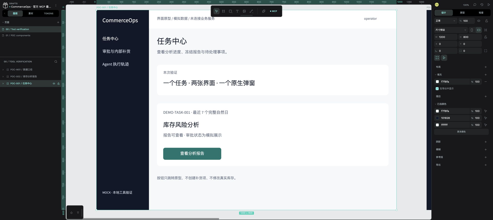

# 本地设计工具链与M1产品设计索引

日期：2026-10-09（Asia/Shanghai）。阶段A/B已提交工具验证；C1修订0.2.1已通过产品评审；本轮交付 **获准C2-B1a原生视觉样板供评审**。B1b/B2/B3尚未授权。现有POC不代表业务功能、权限服务或M1 Gate已完成。

- **[B1a视觉交付、截图、组件、实点证据与限制](c2-b1a-delivery.md)**
- [正式M1 UUID映射](evidence/c2-b1a/design-map.json)
- **[C1完整方案：旅程、权限、交互矩阵、风格、待决策](c1-product-design.md)**
- [18个逻辑界面逐页详设（含F02 proposal）](c1-screen-specs.md)
- [已接受设计决策、后端待确认合同与最低恢复保障](c1-decisions.md)
- [C2第一批及后续批次/验收计划](c2-batches.md)
- [Prediko Pia / Sidekick / Moby官方研究](c1-research.md)
- [C1评审清单与实际检查](c1-validation.md)

- [选型与限制](tool-selection.md)
- [实际验证与验收边界](acceptance.md)
- [提交前实际检查](validation.md)
- [产品交互原则草案](product-ux.md)
- [页面导航草案](sitemap.md)
- [页面与状态](screens.yaml)、[事件与动作](interactions.yaml)、[POC 设计值](design-tokens.json)
- [真实画布 ID 映射](evidence/design-map.json)、[实际点击事件](evidence/prototype-ui-events.json)
- [独立部署与维护](../../tools/design/penpot/README.md)

`POC-*` 是已制作的工具测试界面；`M1-*` 是正式产品ID；B1a样板已映射，其余清单仍待后续获准批次。两者不得相互冒充。YAML 文件采用 YAML 1.2 兼容的 JSON 语法，目前可用标准 JSON 解析器检查。`contract_version=0.2.1-c1-revision` 与 `visual_revision=ux-poc/0.1.1` 分别描述C1评审稿和原样保留的测试画布，不表示全部M1视觉或业务Gate通过。47个事件ID中B09为不渲染的保留ID，其余46项为计划交互；18个逻辑界面含F02渠道proposal，全部未实现业务。其中5个B1a样板已映射正式文件（S09/M03仅最小覆盖）；14个控件实例实点，视觉待评审。BC01–BC07仍待后端确认；授权仅B1a。

本分支基于 main `a0d521e`，不修改 Phase 1 主控的 STATUS、G3、CI、业务数据库或真实飞书配置。该 commit 的 STATUS 仍包含较早的“PR #9 待合并”记录，而实际 Git 已含 PR #9 merge；本轮以产品文档为范围依据，不代替主控修订阶段事实。

