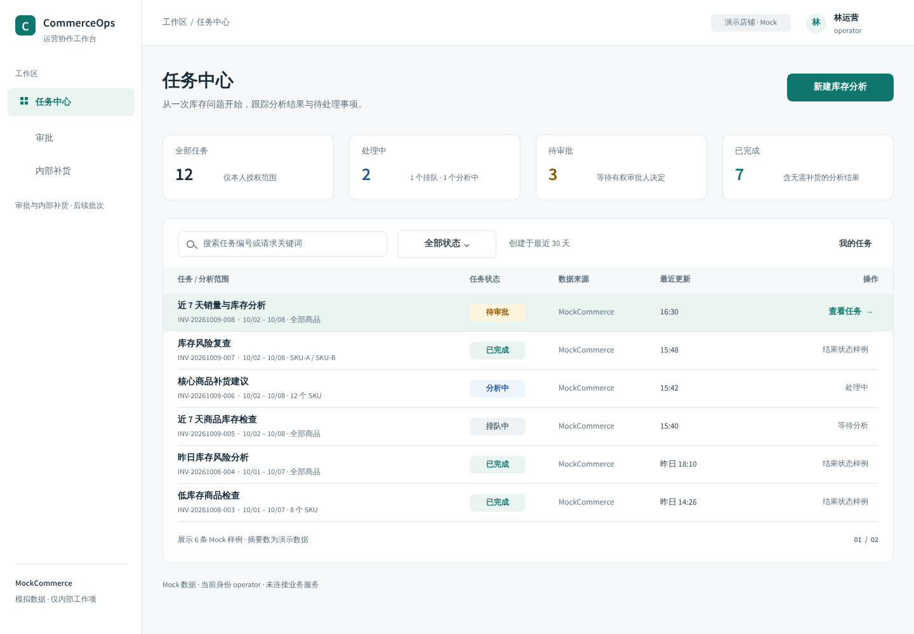
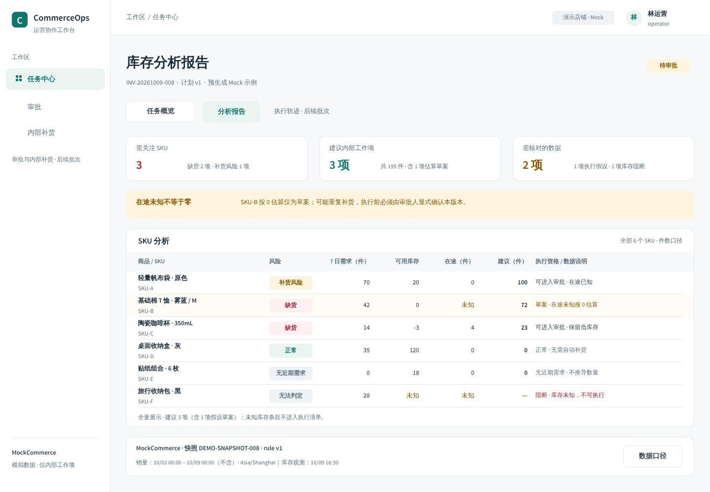
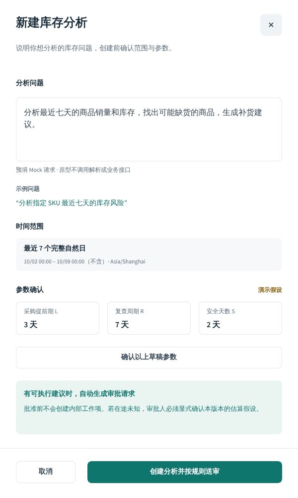
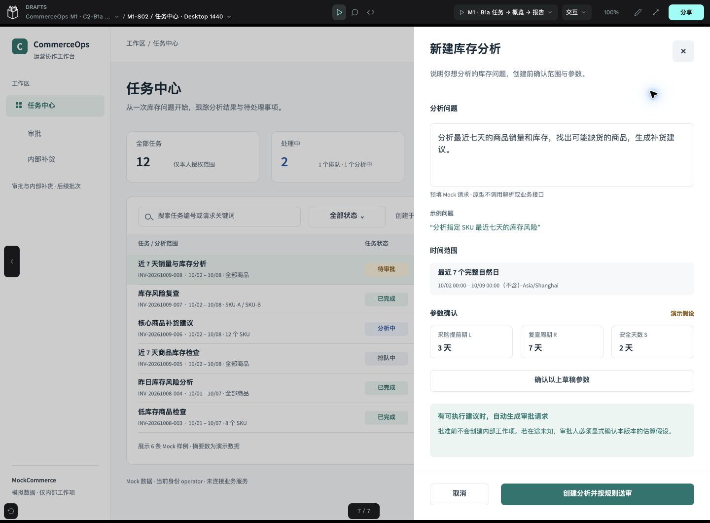

# C2-B1a · 正式视觉样板与原型交付

日期：2026-10-09（Asia/Shanghai）。产品合同 `0.2.1-c1-revision` 已获用户评审确认；本次仅获授权制作B1a。视觉版本 `m1-ui/0.1.0-b1a`。**后续评审记录：用户在2026-10-09明确确认B1a视觉通过，并授权B1b；原交付证据保持。** 以下为B1a当时的范围与限制；B2/B3未授权，所有业务实现状态仍为not_implemented。

## 1. 正式文件与实际范围

[打开正式设计文件](http://localhost:19001/#/workspace?team-id=ad74bff8-48e8-8141-8008-c316c295541a&file-id=7fd0f7d0-fdda-81c5-8008-c340d1377488&page-id=7fd0f7d0-fdda-81c5-8008-c340d1377489) · [打开真实Viewer主Flow](http://localhost:19001/#/view?file-id=7fd0f7d0-fdda-81c5-8008-c340d1377488&page-id=7fd0f7d0-fdda-81c5-8008-c340d1377489&section=interactions&frame-id=7e34228d-e3a9-80dc-8008-c343160c8626)。只在本机可访问，不公开分享。

文件容器通过官方UI新建/命名，原生内容通过官方MCP创建与修订。

文件名：CommerceOps M1 · C2-B1a 视觉样板；file UUID `7fd0f7d0-fdda-81c5-8008-c340d1377488`。原POC文件没有覆盖。3个原生Page：核心界面、Foundations组件/设计值、局部状态样例。

| ID | 本批实际内容 | Board UUID |
|---|---|---|
| M1-S02 | 1440×1000任务中心；身份/来源、状态摘要、筛选区、6条Mock样例 | `7e34228d-e3a9-80dc-8008-c343160c8626` |
| M1-M02 | 600×1000原生右侧抽屉；预填问题、示例、7完整日、演示参数、草稿确认与提交模拟 | `7e34228d-e3a9-80dc-8008-c344aef944e1` |
| M1-S03 | 1440×1000报告；风险/建议/数据核对、6SKU事实、来源与口径 | `7e34228d-e3a9-80dc-8008-c343ef474cf4` |
| M1-S09 | 1440×1000最小导航骨架；预生成Mock结果入口 | `7e34228d-e3a9-80dc-8008-c344afb521e9` |
| M1-M03 | 560×580最小只读口径弹窗，为报告入口提供实际目标 | `7e34228d-e3a9-80dc-8008-c344b0081036` |

另有两个控件所属的只读预览/草稿确认overlay，不新增产品路由。S09/M03的最小覆盖不记为完整页面功能完成。审批、内部项、完整轨迹、飞书卡片未在本批制作。

## 2. 实际视觉预览

以下是官方MCP从可编辑原生Board导出的PNG，不是生成HTML截图或整张图片铺入画布。

真实Viewer打开状态（1440×1060浏览器viewport，含Viewer工具栏）：

[任务Viewer截图](evidence/c2-b1a/viewer-task.jpg) · [报告Viewer截图](evidence/c2-b1a/viewer-report.jpg) · [概览骨架](evidence/c2-b1a/overview.png) · [画布平铺](evidence/c2-b1a/canvas.jpg)。原生界面均在核心Page横向平铺，可逐个缩放编辑。

## 3. 组件、设计值与相对POC的调整

18个原生组件：5种按钮、8种状态标识、AppShell、SKU Flex行资产、loading/empty/error三种局部状态。实际界面使用Shell、按钮和状态组件实例；表格使用统一Flex行/单元格结构，新增SKU行资产供后续获准批次复用，不宣称全部行都已绑定同一个行组件。

官方回读为523个原生对象、280个Text、168个Board、133个Flex容器、237个有token绑定的对象；无image fill。组件关联对象数包含组件后代，不等于独立组件实例数。5种LibraryTypography、18种LibraryColor和33个Native Token已建立。

| 项目 | POC | B1a候选与理由 |
|---|---|---|
| 侧栏 | 深色 | 白色+浅青选中态，减少大面积深色对业务表格的干扰 |
| 背景/正文 | `#F7F8FA` / `#101828` | `#F6F8FA` / `#172B3A`；次级文字`#5C6F7D` |
| 主操作 | `#0F766E` | 保留；状态独立使用蓝/琥珀/红并带文字 |
| 字级 | 多种POC试验值 | 页面28、区域18–24、正文14–16、表格13、辅助12；实际native font为Source Sans Pro |
| 布局 | 1200宽测试画面 | 桌面1440、侧栏224、顶部72、内容左右32；新建抽屉600 |
| 表格 | 文本行测试 | 独立单元格、数字右对齐、单位进列头；任务行60、SKU行46 |
| 按钮/圆角 | 48高，卡片12、modal16 | 按钮44高/8圆角，卡片12，抽屉贴边；关闭按钮44×44 |

[design-tokens.json](design-tokens.json)保留原POC区并新增m1_candidate，绑定独立文件/revision；不将候选视觉值写成已获用户视觉确认。Native TokenCatalog及颜色fill绑定已回读；间距/字号/圆角token存在，但没有声称全部属性已绑定或自动同步Next.js代码。

主要实际配色的计算对比度：主色对白5.47:1；次级文字对画布4.90:1；琥珀告警对浅底5.59:1；红色错误对浅底5.88:1；较浅的小字号颜色从3.92:1调整为对白4.73:1。此为所列颜色对的计算，不是完整WCAG/读屏验收；输入焦点、边界对比与键盘行为仍需后续实现验证。

中文在Chrome Viewer和MCP PNG实际检查，无已发现溢出/缺字。仍使用可用的Source Sans Pro及渲染环境CJK fallback，未安装或打包新的中文字体。Native Flex采用视觉方向修正；生成Next.js时应按语义列顺序实现，不能机械复制Plugin API的子对象顺序或生成CSS。

## 4. Mock数据与行为边界

报告样例：SKU-A需求70、库存20、可靠在途0→建议100；SKU-B需求42、库存0、在途null按0估算→草案72；SKU-C需求14、库存−3、在途4→建议23。三项合计195件。SKU-D正常、SKU-E无近期需求、SKU-F库存未知阻断（建议为未知，不伪造0）。退款件数独立记录，当前解释为确定性示例，未调用模型。

任务摘要与6条表格行是醒目标注的Mock展示，并非数据库查询的全量记录。原型提交直接进入预生成Mock概览/报告，只模拟路径；**没有受理任务、采集库存、生成真实审批或创建内部工作项**。自然语言和搜索框是原生可编辑设计字段，Viewer不是真实可键入的Web表单；筛选仅打开选项预览，不执行查询。BC01–BC07仍pending，未虚构API。

## 5. 实际原型验证

[28次Viewer点击记录](evidence/c2-b1a/prototype-ui-events.json)含动作、稳定ID、实际AX状态与结果，全部passed；覆盖14个控件实例（11个语义控件ID）。

| 路径 | 实际结果 |
|---|---|
| B10打开抽屉，B45×/取消关闭 | 原生open-overlay/close-overlay；文字和背景命中均已验证 |
| B35确认草稿与返回 | 只打开/关闭Mock确认overlay，无业务决定 |
| B01模拟提交 | 跳S09预生成Mock导航骨架；不计真实受理/分析 |
| B14任务行→S09→B15报告 | 按既定任务概览结构导航，未直接绕过概览 |
| B18口径→B22返回/背景关闭 | 原生弹窗打开/关闭，关闭不批准或拒绝 |
| B29报告→概览→B39任务中心 | 返回路径通过；按钮背景命中通过 |
| B13筛选预览/关闭 | 显示pending说明，无实际过滤或业务查询 |

未制作的导航在侧栏明确标注后续批次；没有伪造审批/补货按钮。当前只验operator Mock视觉，不计四角色授权、真实飞书、HTTP幂等、库存规则或业务T3/T4/T6通过。

## 6. 自检、问题与修复

- 初次连接同时存在另一个浏览器的POC MCP会话，出现心跳暂停/重复连接；保留[原始失败](evidence/c2-b1a/connection-failures.json)。仅重启既有隔离MCP服务一次并改用单一Chrome工作区；未改部署/密钥/上游源码，文件ID保护阻止写入旧POC。
- Penpot会规范化图层名称中的斜杠，初次精确名称查找失败；改用稳定plugin data检索，继续已有部分构造，没有重复重建页面。
- 非活动Page的样式/跨Page clone操作被官方API拒绝；按活动Page分步处理，创建独立行资产，并移除本批产生的临时失败clone。原行及UUID保留。
- 加入Flex后出现列/文本次序反转：[修复前实际图](evidence/c2-b1a/report-before-flex-fix.png)。修正方向及标题/元信息顺序，回读和最终PNG确认恢复；透明单元格保留整行背景，任务动作调整到列宽内。
- 默认Viewer初次落在辅助弹窗；清理本文件自动生成的额外Flow，仅保留主Flow，以任务中心Board作入口，并另附[默认入口复验](evidence/c2-b1a/entrypoint-check.json)。
- 调整较浅的小字号颜色、角色字号及报告面包屑。最终5个界面的API textBounds/几何检查均无溢出/越界，原生file.validate为空。

[实际MCP请求/响应](evidence/c2-b1a/mcp-executions.json)保留成功和失败。它们是历史操作证据，不是可安全重复执行的脚本；不要在已完成文件重放创建请求。

## 7. 保存、回读与最低恢复保障

修改前核实原POC命名版本存在、服务独立且loopback访问，并新建私有PG+assets配套备份，读取pg_restore目录与tar成员验证可读；不是还原测试。新正式文件先保存空白基线，完成后保存：`m1-ui/0.1.0-b1a / visual QA + 28 Viewer clicks + main entry`。

[命名版本记录](evidence/c2-b1a/save-version.json) · [刷新后真实回读](evidence/c2-b1a/after-reload-read.json) · [私有备份脱敏摘要](evidence/c2-b1a/backup-summary.json)。刷新后5个Board、14控件实例、18组件及33个活动token仍存在，ID/revision/动作保持。批次结束再次做私有备份，目录0700、文件0600，备份/配置不入库。

PG dump与assets tar不是跨存储原子事务；本次只停止设计写入，未进行异机/新卷恢复。原生.penpot导出缺口继续单列，不承诺灾难恢复、RPO/RTO；截图及规范不是可编辑文件归档。不扩展基础设施。

## 8. 尚未验证与交接

未验1280/窄屏真实响应式布局、键盘/读屏/焦点、hover/focus状态、真实表单输入与搜索筛选、四角色授权/兼任、完整S09/S03状态集合、审批/内部项/飞书、长期MCP稳定性或异机恢复。1440只是本批实际画布与Viewer验证宽度；固定画布缩放不叫响应式实现。

[screens.yaml](screens.yaml)、[interactions.yaml](interactions.yaml)登记本批映射和覆盖范围，业务status与implementation不升级。[design-map](evidence/c2-b1a/design-map.json)记录5个界面、14个动作控件实例、6个设计字段、组件/token和辅助overlay UUID；后续用稳定ID互相定位。

Next.js实施仍须读取产品合同、已获视觉确认的版本、BC合同确认记录，再以Playwright和领域/真实飞书测试验业务。B1a到此停止，B1b/B2/B3须用户另行授权。

## 9. 本次仓库检查

| 实际检查 | 结果与边界 |
|---|---|
| `ruff format/check tools/design/penpot/check_contract.py` | 通过；只扩展设计合同检查，未改业务代码/CI |
| `python tools/design/penpot/check_contract.py` | POC历史引用保持；5样板/14控件/28点击与刷新后动作、命名版本一致 |
| `python -m scripts.check_docs` / `git diff --check` | 31份Markdown，errors=0；本地链接/围栏/差异空白通过 |
| 结构化与Mock数据核对 | 5Board/14动作实例/6字段一致；POC数组及原设计值不变，业务枚举不变；三项195件按规则复算 |
| `python -m scripts.scan_secrets` | 当前内容、index、全部可达历史findings=0；暂存后再次运行 |
| 设计服务当前日志实际凭据值匹配 | 0命中，只输出脱敏结果；原始配置/日志/备份不上传 |

GitHub基础CI按本次最终head的实际结果在PR核对，不把上一提交成功转记；不等于M1业务或全部UX验收。

## 10. B1b授权承接

用户明确确认B1a视觉评审通过并授权C2-B1b；使用同一工作树、分支、PR #24与正式M1文件。B1a截图、UUID历史映射和28次点击证据保留，不以它们替代B1b验证。当前设计版本及本批证据见[B1b交付](c2-b1b-delivery.md)。

## C2-B2 承接（2026-10-09）

用户已转述 B1b 外部视觉与交互评审为有条件通过，并明确授权 B2。三项必要修订与本批当前版本见 [B2 交付](c2-b2-delivery.md)。本文件此前的截图、UUID 和测试是历史证据；不改写为 B2 验证。B3 仍未授权。
