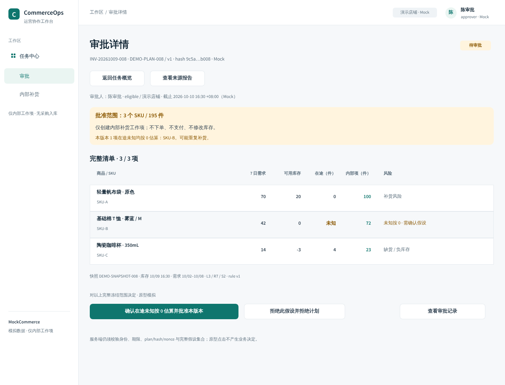
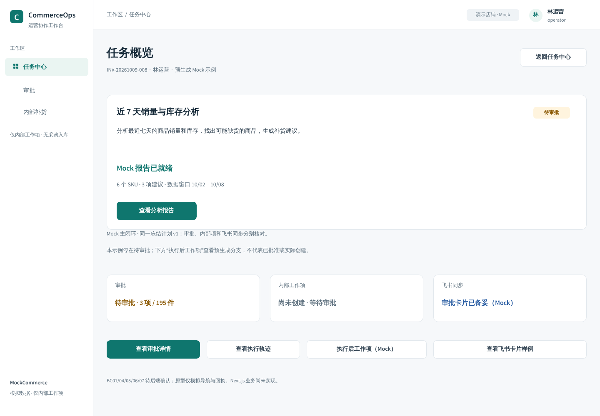
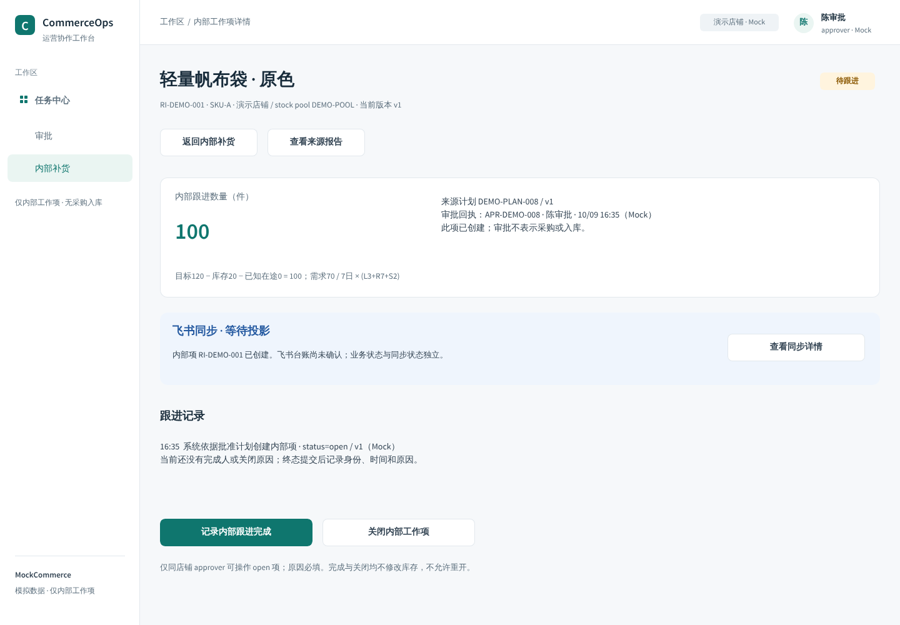
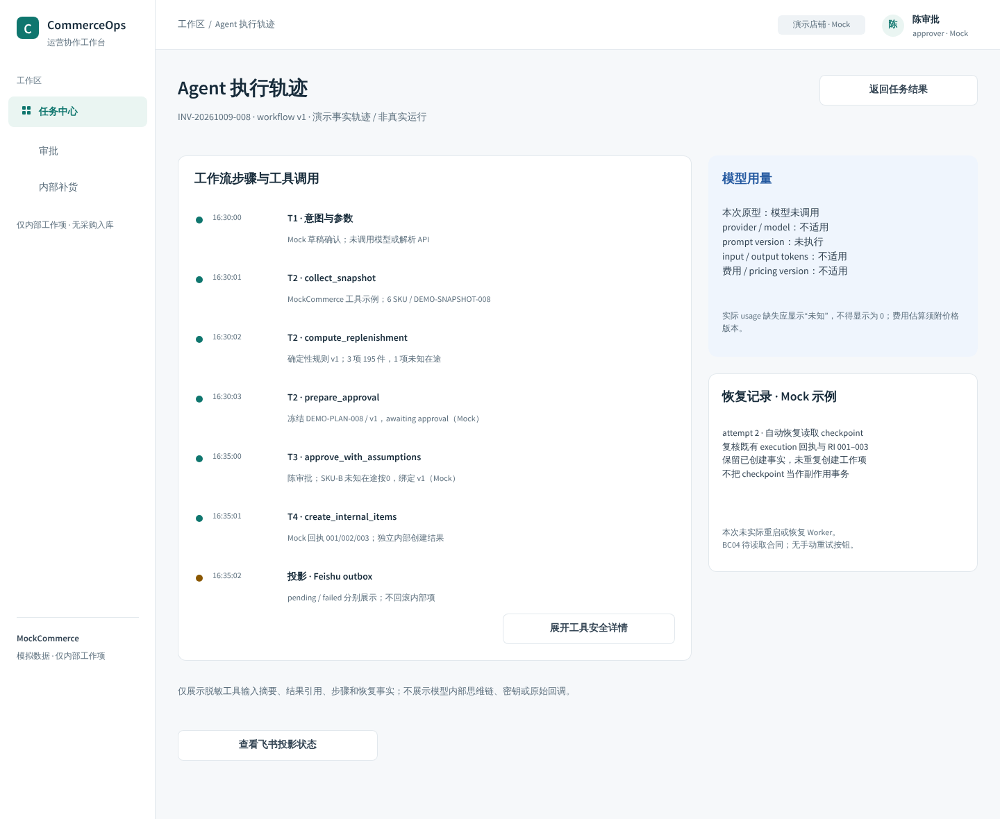
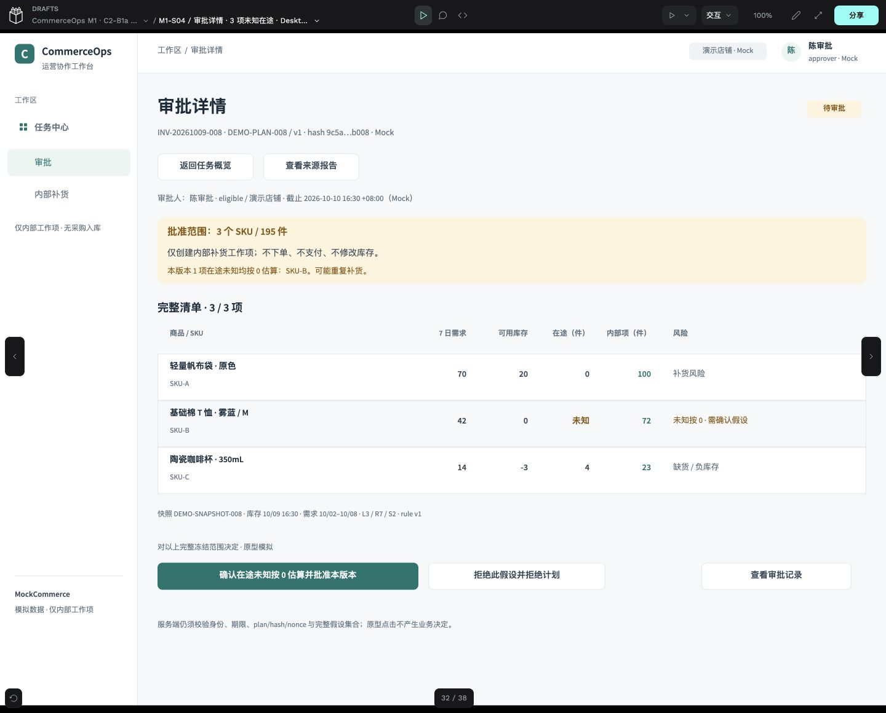
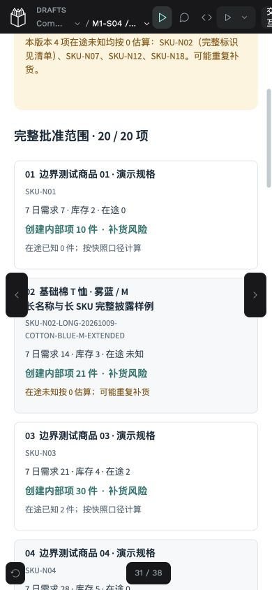

# C2-B1b · 正式 UI 与主闭环原型交付

日期：2026-10-09（Asia/Shanghai）。用户明确确认 B1a 视觉评审通过并授权本批。产品合同 `0.2.1-c1-revision`；视觉版本 `m1-ui/0.2.0-b1b`。**本批设计与原型完成，等待视觉和交互评审；不代表业务实现、M1 Gate 或 main 合并。** B2/B3 未授权。

## 1. 沿原文件增量交付

使用原 UX 工作树、`codex/ux-penpot-toolchain`、[PR #24](https://github.com/aning0922/commerceops-agent/pull/24)。起始 head `3514e1e`、分支基线 main `a0d521e`；原 UX 会话在开始前为 idle，最后交付已停写。没有重部署工具、覆盖 POC 或重建 B1a 页面。工作树仍归原会话管理，本会话直接在获授权的原目录操作；没有创建第二工作树。

[正式 Penpot 文件](http://localhost:19001/#/workspace?team-id=ad74bff8-48e8-8141-8008-c316c295541a&file-id=7fd0f7d0-fdda-81c5-8008-c340d1377488&page-id=7fd0f7d0-fdda-81c5-8008-c340d1377489) · [Viewer 主入口](http://localhost:19001/#/view?file-id=7fd0f7d0-fdda-81c5-8008-c340d1377488&page-id=7fd0f7d0-fdda-81c5-8008-c340d1377489&section=interactions&frame-id=7e34228d-e3a9-80dc-8008-c343160c8626&index=0)

仅本机可访问，未公开分享。正式 file UUID `7fd0f7d0-fdda-81c5-8008-c340d1377488`、核心 page UUID `7fd0f7d0-fdda-81c5-8008-c340d1377489` 保持；文件标题仍沿用原 `CommerceOps M1 · C2-B1a 视觉样板`，核心 Page 已命名为 `01 / B1 · 主闭环与审批披露`，当前版本由原生命名版本和 revision 标记辨识。原 3 个 Page、18 个组件和 33 个 Token 保留。

| 逻辑 ID | 本批交付 | 主实例 UUID |
|---|---|---|
| M1-S10 | 审批列表、完整详情入口、筛选只读预览、独立历史回执 | `448723ff-8a21-80dc-8008-c374bd2e0442` |
| M1-S04 | 主任务 3 项审批；390px 1/20项；只读/披露阻断局部场景 | `448723ff-8a21-80dc-8008-c373bf383a49` |
| M1-S05 | 内部补货列表，数量、来源与独立飞书同步状态 | `448723ff-8a21-80dc-8008-c374bef22ae3` |
| M1-S11 | 单项详情，另有 B/C 只读详情及完成/关闭终态回执 | `448723ff-8a21-80dc-8008-c37519b581cc` |
| M1-M01 | 完成/关闭原因：默认空白、显式 Mock 示例与提交反馈 | `448723ff-8a21-80dc-8008-c3751c128013` |
| M1-S06 | 工作流、工具、安全详情、模型用量与 Mock 自动恢复记录 | `448723ff-8a21-80dc-8008-c375809431d6` |
| M1-F01 | 390px 卡片规格，已知 1 项和未知 20 项，与 Web 同冻结版本 | `448723ff-8a21-80dc-8008-c373c88a718a` |
| M1-S09 | 在原 UUID 上完善三类状态、审批/轨迹/内部项关联 | `7e34228d-e3a9-80dc-8008-c344afb521e9` |

整体覆盖 8 个 Web 逻辑页面、3 个辅助层和 1 个飞书卡片规格。核心 Page 有 **36 个页面/布局/局部场景实例**，另保留 B1a 的 2 个控件辅助 overlay；120 个稳定控件实例均有原型目标。一个 ID 的多个窄屏或状态实例分别登记 UUID，不计为新增产品路由。详见[当前映射](evidence/c2-b1b/design-map.json)和[Viewer 索引](evidence/c2-b1b/viewer-index.json)。Viewer 的 index 是当前画布位置索引，后续增量新增 Board 时需重新回读，不能把旧索引当作稳定 ID。

## 2. B1a 小幅优化与组件复用

- 任务中心主按钮明确为“向 Agent 提问”，底部增加自然语言示例和“开始提问”入口；两者都打开原 M02 抽屉。
- 原报告增加简洁的智能分析摘要：6 项已核对、3 项建议共 195 件、SKU-B 未知在途、SKU-F 库存未知阻断；显示 `100 + 72 + 23 = 195` 与“未调用模型”。
- 原抽屉将草稿确认缩为次级“第 1 步 · 核对草稿参数”，提交保留底部主操作“第 2 步 · 提交分析（模拟）”，草稿确认不会创建任务。
- S02/S03/M02/S09/M03 的 Board UUID 保持。报告为容纳摘要增高至 1080，没有重新生成原表格或页面。

复用 B1a 原生 AppShell、按钮和状态组件实例；沿用 Source Sans Pro、实际 CJK fallback、白色侧栏/青绿主操作、表格数字右对齐、分列和行结构。已有 SKU 行组件资产保留，但没有声称所有新表格行都绑定同一行资产。Native TokenCatalog 仍为 `CommerceOps/M1-B1a`、33 项，没有重复创建 Token Set；颜色绑定回读 896 个对象，间距/字号/圆角并非全部绑定，也未自动同步代码。

核心 Page 最终回读：1451 个原生对象、925 个 Text、210 个 Flex 容器；image fill 为 0。组件与设计值区保持可编辑原生资产，不用整张图片替代界面。

## 3. 实际视觉截图与优先自检

先完成审批详情和飞书卡片并导出视觉检查，再继续列表、内部项、原因层、概览与轨迹。发现桌面表头错位后改为独立列标题；最终数字与列头对齐，未知、负库存及范围说明可读。

[审批列表](evidence/c2-b1b/approval-list.png) · [内部补货列表](evidence/c2-b1b/items.png) · [任务中心优化](evidence/c2-b1b/task.png) · [报告与摘要](evidence/c2-b1b/report.png) · [抽屉按钮层级](evidence/c2-b1b/drawer.png) · [空原因](evidence/c2-b1b/reason-empty.png) · [显式示例原因](evidence/c2-b1b/reason-valid.png)

[飞书 1 项原生规格](evidence/c2-b1b/feishu-known.png) · [飞书 20 项原生规格](evidence/c2-b1b/feishu-20.png) · [Web 20 项原生规格](evidence/c2-b1b/web-20.png) · [390px 飞书首屏](evidence/c2-b1b/viewer-feishu20-top-390.jpg) · [390px 飞书末项与动作](evidence/c2-b1b/viewer-feishu20-last-actions-390.jpg) · [390px Web 末项与动作](evidence/c2-b1b/viewer-web20-last-actions-390.jpg)

PNG 为官方 MCP 从可编辑 Board 导出，JPG 为真实 Chrome Viewer 截图。390px 截图中的黑色顶栏、翻页箭头和计数属于 Penpot Viewer，偶尔遮住侧边内容，不是设计页面的悬浮批准控件；原生 PNG 和几何回读用于核对完整内容。此为 **390px 专门布局实例在 100% 缩放下的原型检查**，不是响应式 Next.js 或真实飞书客户端验收。

## 4. 冻结计划、状态与模拟边界

| 场景 | 冻结计划 | SKU / 件数 | 未知在途 | 操作 |
|---|---|---|---|---|
| B1a 主任务延续 | DEMO-PLAN-008 / v1 | 3 / 195 | SKU-B 1项 | B03 / B04 |
| 已知在途边界 | DEMO-PLAN-K01 / v1 | 1 / 100 | 0 | B02 / B05 |
| 长 SKU / 多未知边界 | DEMO-PLAN-N20 / v1 | 20 / 2276 | N02、N07、N12、N18 共4项 | B03 / B04 |

主任务仍沿用真实 Mock 计算事实：A `120−20−0=100`、B `72−0−0=72`、C `24−(−3)−4=23`。库存未知 F 不进批准清单。20 项是独立、明确命名的确定性边界 fixture，不混入主任务 3 项结果；每项按 `max(0, target−stock−effective_inbound)` 复算，未知的原始 inbound 仍保留 null，仅计算假设按0。

Web/F01 的 1 项与20项分别共享相同 plan_id/version/hash、全量 SKU、数量、参数与 Mock 截止时点。全部清单和风险默认展开；最终按钮位于清单之后。未知在途没有普通批准旁路、默认勾选或永久确认。披露不完整/版本不一致局部场景无批准入口，读取完整版本后再决定。真实期限、容量、授权、exact assumption keys 和幂等仍由后端合同落实，UI 不构成授权。

批准先导航到“审批记录已保存 / 内部项等待执行 / 飞书待投影”回执。主任务另有“内部项已创建 / 飞书 pending或failed”Mock 回执；不能把批准或同步成功直接当成业务完成。历史 APR-DEMO-H01 使用自己的只读回执，未借用主任务版本。终态完成/关闭记录身份、时间、原因，无重新打开入口，也不表示下单、付款、到货或库存修改。

原因层默认空白并禁用提交；“选择 Mock 示例原因”是显式切换预填演示场景，非系统默认原因。Viewer 原生设计字段不是可键入的 Web 表单，没有执行原因校验 API 或真实状态更新。

Agent 轨迹显示 T1–T4、工具名称/规则版本/结果引用、独立投影与自动恢复示意。模型未调用，token和费用显示不适用；实际 usage 缺失不得写为0。工具耗时、审批时间和 attempt 2 恢复记录醒目标明 Mock/示意，**本批没有实际运行 Worker、重启恢复或执行模型**。不展示模型内部思维链、密钥、原始回调或客户 PII，也没有 B09 通用恢复操作。

operator 只读动作区与 approver 操作区分开。原型身份只是展示变体，BC01–BC07 保持 pending，全部业务 implementation_status 为 not_implemented。列表筛选只展示选项，不执行真实查询；77次原型点击不计为权限、审批、库存、幂等、飞书回调或业务 T3/T4/T6 通过。

## 5. 实际 Viewer 验证与已修复问题

[77 次实际点击记录](evidence/c2-b1b/prototype-ui-events.json)：**73 次当场通过，4 次失败保留并有对应复验**，最终核心路径通过。不是“77次全部一次通过”，也没有声称120个实例均逐一独立点击。记录包含稳定ID、已定位的实例UUID、文字/背景动作、实际AX结果；早期 AX 点击未回传UUID的项可结合当前映射、来源画面和文案定位。

| 实际检查 | 结果 |
|---|---|
| Agent入口→M02→草稿确认→模拟提交→S09→S03 | 通过；两个入口、确认返回、取消关闭已验 |
| S03→S04→拒绝→返回；批准→记录→独立创建结果 | 通过；批准背景命中已验，不直接写成业务完成 |
| S10→详情/只读/披露阻断；历史回执与只读筛选 | 通过；不提供列表一键批准 |
| S05→S11→空原因→取消；显式示例→完成/关闭终态 | 通过；关闭弹层以 overlay 确实消失核验 |
| S09/S03→S06→工具详情→返回→投影详情 | 通过；模型未执行，恢复为Mock事实示例 |
| 390px Web/F01，1/20项批准与拒绝 | 两类操作分别通过；全量滚动、长SKU、多未知与末项检查 |
| 飞书20项→Web同版本完整详情 | 通过；plan与20项/2276件一致 |
| 中文、原生文字边界、页面几何、file.validate | 刷新后均无已发现缺字/溢出/越界；validate为空 |

失败与修复：

- 第24次：无填充的侧栏 Board 不接受背景命中。保留同UUID，以极低不透明度绘制命中区域，去除会覆盖文案的异步白色Token填充；第25次复验通过。
- 第33次：审批详情返回缺少原型连接，来源/记录同属该构造缺口。补齐三个原控件目标，不新建控件；第34次及58/62/64次复验通过。
- 第53/54次：临时 viewport 下的原生坐标点击没有可靠命中；原“取消”弱断言会被背景内容满足。保留失败并加强断言，改用稳定UUID作用域的DOM文字点击；第55/72次复验，取消 overlay 确实消失。
- DOM snapshot 不含SVG文字，初次第1次验证观察方法不足；通过真实AX与截图补核，保留原观察和修正说明，不把它算成业务失败。
- MCP出现心跳暂停、空字符串 setter拒绝、File.name只读拒绝、批量字体遍历超120s。保留[成功/失败请求](evidence/c2-b1b/mcp-executions.json)，检查已有部分后继续，无重新部署、无全页重放。通过重排修复API文字已更新而Viewer仍显示旧文案的问题；刷新后字体恢复整数，最终截图与回读一致。

[窄屏滚动观察](evidence/c2-b1b/narrow-observations.json)记录实际可见SKU及位置。1/20项范围和件数还在[刷新回读](evidence/c2-b1b/after-reload-read.json)逐项核对，Web与F01相同。工具失败的输出也保留，执行命令exit 0不被当作MCP成功。

## 6. 保存、回读与私有备份

写入前保存 B1a 已批准基线命名版本并维护私有PG＋assets配套备份。最终先完成 Viewer 测试，再刷新原编辑页、重新连接官方MCP，纯只读回验 UUID、交互、字体、组件/Token和四个窄屏清单；随后固定已经持久化的内容：

`m1-ui/0.2.0-b1b / persisted review-ready · 77 Viewer attempts + 390px`

保存时间 2026-10-09 21:58:33（Asia/Shanghai），native revn=32；[命名版本记录](evidence/c2-b1b/save-version.json)与[刷新回读](evidence/c2-b1b/after-reload-read.json)已保存。未通过恢复版本来覆盖当前文件，未新开MCP服务。

最终命名版本后再次按既有维护流程做PG＋assets私有备份；目录0700、文件0600，pg_restore目录与assets成员可读，摘要及SHA-256见[备份记录](evidence/c2-b1b/backup-summary.json)。凭据、备份正文、运行配置不入Git。

PG与assets顺序捕获，不是跨存储原子事务；本批没有异机/新卷还原，也没有填补原生.penpot导出缺口。截图不是可编辑归档，不承诺灾难恢复、RPO/RTO。上述工具缺口继续单列，未扩大基础设施范围。

## 7. 评审边界与仓库验证

未解决的验证边界：真实飞书卡片容量/回调/转发权限；生产数据与服务端身份/版本/幂等；真实键入和校验；键盘、读屏、焦点；除审批外其他页面的窄屏响应式；长期MCP稳定性；异机恢复。BC01–BC07未确认的功能仍模拟或待实现，未新增状态枚举/API。黑色Viewer导航可能遮住局部文字，评审可结合原生PNG与可编辑Board查看。

没有当前已知的核心原型断链、未披露批准范围、文字溢出或未解决的上述实点失败；四条失败通过后续记录解决。未将局部场景扩展为B2登录/权限全矩阵或B3重新发起/异步澄清功能。

本批提交前运行设计合同检查（含B1a历史保持、B1b UUID/连接/回读、确定性 fixture、命名版本与实际实点记录）、Ruff、文档链接/围栏检查、git diff --check和当前/index/可达Git历史敏感扫描。实际命令结果见[仓库检查记录](evidence/c2-b1b/repository-validation.json)。GitHub CI须核对本次新head，不转记旧head成功；PR更新中登记实际结果。

本批到此停写，等待视觉与交互评审。不合并main，不开发Next.js正式业务，不修改Phase 1 STATUS/实现/真实飞书，不启动B2/B3。

## C2-B2 承接（2026-10-09）

用户已转述 B1b 外部视觉与交互评审为有条件通过，并明确授权 B2。三项必要修订与本批当前版本见 [B2 交付](c2-b2-delivery.md)。本文件此前的截图、UUID 和测试是历史证据；不改写为 B2 验证。B3 仍未授权。
