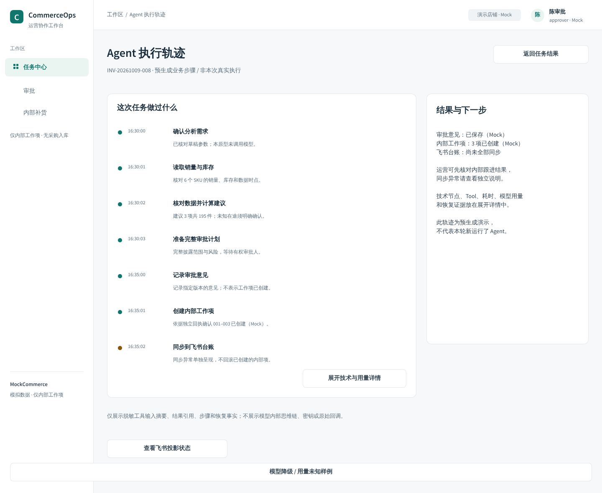
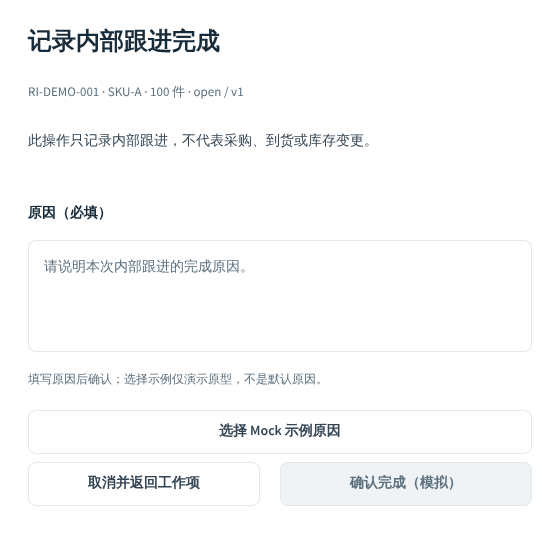
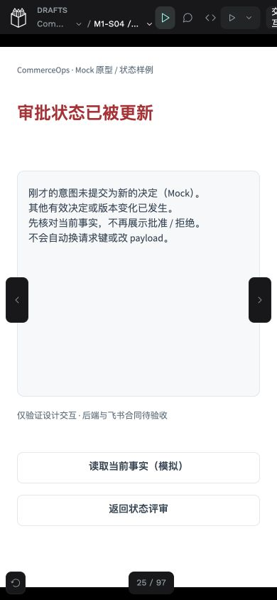
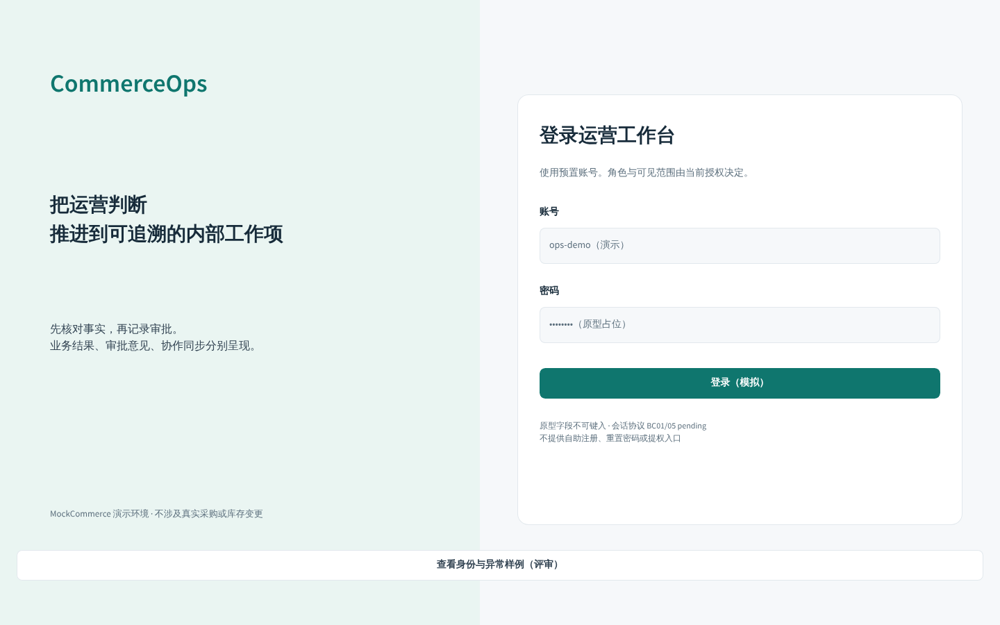

# C2-B2 · 身份、异常与交互完善交付

日期：2026-10-09（Asia/Shanghai）。合同 `0.2.1-c1-revision`，设计版本 `m1-ui/0.3.0-b2`。用户转述 B1b 外部视觉及交互评审为有条件通过，明确授权本轮 B2。**本批设计原型与 UX 合同候选已交付，等待外部评审；未合 main，未启动 B3 或真实业务开发。**

## 1. 基线、唯一写入者与评审入口

沿原 UX 工作树、`codex/ux-penpot-toolchain` 和 [PR #24](https://github.com/aning0922/commerceops-agent/pull/24)。开始核对远端 head `161035fc44069a8d9344c85f297e50dda160cb29`，本地工作树干净。读取 C1 产品/页面/权限决策、C2 批次、B1a/B1b 交付及当前原生版本；B1b 会话为 idle，最后交付明确停写并断开 MCP，本轮未向其派发任务，未创建第二个设计写入者。原 Phase 1 与规划工作树只读；main 仍为 `a0d521ed79505287fa61bb6ddf82640e97824257`。

[正式设计文件](http://localhost:19001/#/workspace?team-id=ad74bff8-48e8-8141-8008-c316c295541a&file-id=7fd0f7d0-fdda-81c5-8008-c340d1377488&page-id=7fd0f7d0-fdda-81c5-8008-c340d1377489) · [B2 Viewer 登录入口](http://localhost:19001/#/view?file-id=7fd0f7d0-fdda-81c5-8008-c340d1377488&page-id=7fd0f7d0-fdda-81c5-8008-c340d1377489&section=interactions&index=55)

仅本机可访问，未公开分享。file UUID `7fd0f7d0-fdda-81c5-8008-c340d1377488`、核心 page UUID `7fd0f7d0-fdda-81c5-8008-c340d1377489` 保持；原 POC 未覆盖，正式文件仍沿用 B1a 文件标题。核心 Page 名为“01 / M1 · 主闭环、身份与异常”。Viewer 使用“B2 登录与安全状态”入口；画布帧序号不是稳定 ID，应以 [UUID 与刷新后索引](evidence/c2-b2/viewer-index.json) 和可见帧名称核对。

本批沿用 **18 个原生组件、33 个 Native Token、原 3 个 Page**。核心 Page 当前 **95 个页面/布局/局部场景实例、274 个控件实例、2204 个原生对象**，image fill=0。B1b 原 36 个实例与全部已有控件 UUID 保留；新增 59 个主要是 390/560/600px 的角色、表单和异常面板，另有身份评审入口与两种登录宽度、1280 轨迹。没有为每种状态复制整张 1440px 页面；组件实例不等于新增产品路由。按钮均复用原资产，局部内容区使用原 Token；并不声称所有文本/间距属性都已绑定 Token。

## 2. B1b 三项意见修复

| 意见 | 本批修订 | 实际证据与边界 |
|---|---|---|
| 轨迹默认面向运营 | 七步改为“确认分析需求、读取销量与库存、核对数据并计算建议、准备完整审批计划、记录审批意见、创建内部工作项、同步到飞书台账”；默认只显示业务事实和下一步 | 原 S06、节点与控件 UUID 保留；技术节点、Tool、耗时、模型用量和恢复证据放入 B43 展开详情，展开/收起实点通过 |
| 空原因立即报错 | 初始中性边框与填写提示；B07/B08 的空原因校验尝试才进入字段错误变体；无默认原因 | 87 个成功点击中的第54–59、60–71、74–77步；覆盖取消、校验、示例原因、提交中、冲突、未知及读取原回执。空校验不会形成业务提交 |
| 飞书披露与真实容量混淆 | 保留 1/20项、长 SKU、全部数量及未知在途风险；真实容量明确 pending。当前卡片四枚直接决定控件保留 UUID、禁用且无原型动作 | B21/B29 转入鉴权样例；无权停 S07，有权才到同版本 Web 全量清单决定。不是实际飞书客户端、回调或权限验收 |

[校验后字段错误](evidence/c2-b2/reason-validation.png) · [技术详情](evidence/c2-b2/trace-details.png) · [保留20项并禁用卡片决定](evidence/c2-b2/feishu-20.png)

## 3. 正式范围与状态复用

| 范围 | 原生实例/路径 | 安全语义 |
|---|---|---|
| S01 登录 | 1440 UUID `b806b597-0eb0-80b2-8008-c386bce478fe`；1280 UUID `b806b597-0eb0-80b2-8008-c386be8e2dd1`；登录失败、飞书站内深链鉴权局部面板 | 预置账号表单；字段是原型占位、不可键入。评审身份选择不是产品角色切换或提权入口；真实 principal 仍须服务端验证 |
| S07 访问限制 | 无权身份、无权/不存在统一提示、撤权、会话过期 | 不展示 SKU、受限对象、所有者或计数；清除旧内容。重新登录后重读，不自动重放未提交决定 |
| 四角色及兼任 | operator、approver、admin、unauthorized；operator+approver、admin+operator、admin+approver、三角色兼任 | admin 单角色不获业务读/决定权；兼任按各角色自身动作和 scope 合并，不拼接权限；本人任务不自动 eligible |
| 读取状态 | 共用 loading、empty、read_failure 局部内容组件样例 | loading 不显示虚假0；成功空结果与读取失败分开。重读只读取，不重新执行任务或决定 |
| 审批 | 过期、版本变化、重复决定、提交中、冲突、结果未知；六个390状态 | 无盲重试或相反动作。当前v2未披露时无决定入口；历史v1批准只属于v1。核实既有回执不冒充新执行 |
| 内部项 / M01 | 已完成、已关闭、版本冲突；完成/关闭分别有提交中、unknown、conflict、verified变体 | 原因与原意图/请求键保持；先读当前状态或原回执，终态不能重新打开。旧关闭/完成不变成新执行 |
| 飞书同步 / 外部unknown | sync_failed、sync_unknown局部事实和安全对账提示 | 已创建内部项仍已创建；不因投影失败回滚。保留原provider引用与版本，未知停止盲重发；只说明既有安全运维流程，无手动对账写按钮 |
| 模型 / 数据质量 | 模板降级、usage/费用未知、数据不完整 | 降级不改确定性事实；未知不写0；不完整或缺库存时不提供批准入口 |

读取组件样例以 S02 为展示上下文，机器合同给其他适用页面 `shared_read_state_refs`。这是共用内容区模式的验证，不是为 S03/S05/S06 等每页每个读取状态另造整页、逐一接 API 的声明。权限场景也是指定 Mock 分支，原 B1 展示路径保留为独立演示；原生 Viewer 自带站点地图/翻页可浏览设计帧，不能把设计帧访问当成真正鉴权能力。

operator 演示链为 B10 打开 M02 草稿 → B01 模拟受理 → 预生成本人报告 → 只读审批，无决定入口。approver 及有效兼任才有 eligible 入口；无权或非eligible分支只能看到安全提示。没有新增自审禁令或豁免、全组织读权限、业务 API、通用手动恢复或真实飞书权限。

## 4. Viewer 实际验证、失败与复验

[实际事件](evidence/c2-b2/prototype-ui-events.json) · [验证汇总](evidence/c2-b2/verification-summary.json) · [角色观察](evidence/c2-b2/role-observations.json) · [390观察](evidence/c2-b2/narrow-observations.json)

**96 次 Viewer 验证尝试，其中 87 次实际点击及结果断言通过；9 次在点击前定位失败，保留原记录并有对应复验。** 不是96次全部点击成功，也不是274个控件均独立实点。失败第2–6步是旧渲染标签，分别在7/8/9/12/13步复验；79/81/82是持久化画布索引变化，84/86/87复验；95使用了不准确的动作文案，核对当前文字后96复验通过。

| 实测路径 | 结果 |
|---|---|
| 登录→本人只读报告→只读审批→返回；草稿取消；退出 | 通过；业务决定入口缺席，草稿取消未模拟受理 |
| 8种身份选择、非eligible提示→无权首页 | 通过；安全提示没有受限业务内容或决定入口 |
| 23个共用异常入口、读取失败→加载→成功空 | 通过；未将失败伪装成0 |
| 审批冲突/未知/重复→既有回执；版本变化→当前v2只读 | 通过；无盲重试、跨版本批准或历史执行冒充新执行 |
| 完成/关闭→原因空→校验→示例→提交中→冲突/未知→读取 | 通过；两种取消另用弹层文本确实消失的断言复验 |
| 默认业务轨迹→技术详情→关闭 | 通过；默认没有展开技术数据，用量/恢复为明确Mock示例 |
| 390px过期/版本/重复/冲突/unknown/容量阻断 | 刷新后逐帧名称确认并截图，六种负向动作检查通过；五条读取/深链点击通过 |
| 飞书1/20项→鉴权→同版本Web→对应批准/拒绝；无权分支 | 通过；卡片直接决定已禁用。Web全清单后的决定仍为Mock |

[真实Viewer 初始原因](evidence/c2-b2/viewer-reason-pristine.jpg) · [校验错误](evidence/c2-b2/viewer-reason-validation.jpg) · [历史结果](evidence/c2-b2/viewer-historical-result.jpg) · [飞书末项与禁用动作](evidence/c2-b2/viewer-feishu20-gated-actions-390.jpg) · [鉴权后Web末项](evidence/c2-b2/viewer-web20-after-auth-390.jpg)

其他工具失败见[记录](evidence/c2-b2/verification-failures.json)及[实际MCP执行](evidence/c2-b2/mcp-executions.json)：283文本批量字体刷新/还原超过120秒，保留部分状态，刷新后回读，再按20标签小批处理；旧Viewer缓存与API文案不同步，最终实屏与回读核对；后台浏览器绑定延迟，激活原Viewer恢复；帧名称定位同时匹配隐藏div与可见span，改为可见帧断言。没有为恢复这些工具问题重部署、重建已有页、恢复旧版本覆盖当前内容或开第二个编辑器写入者。MCP历史写请求不可重放。

## 5. 排版、宽度与可访问性边界

1440/1280 两种登录布局、1440/1280 轨迹、六个390局部审批状态及完整SKU卡片/Web均有原生布局或真实Viewer截图。PNG是原生Board导出，JPG是真实Chrome Viewer截图。宽度覆盖是专门原生布局与viewport检查，不是响应式Next.js实现；整个M1全部页面的1280/390布局未逐一验收。

[登录1280](evidence/c2-b2/login-1280.png) · [轨迹1280](evidence/c2-b2/trace-1280.png) · [原生390冲突](evidence/c2-b2/approval-conflict-390.png)

中文自检及刷新后原生几何：未发现可见文字溢出/页面越界，file.validate为空。状态同时使用清楚文案与颜色，不能仅靠颜色辨识；共用动作高度44px。检查的12组活动文本Token颜色对比均≥4.5:1，最小4.90:1；[计算与边界](evidence/c2-b2/contrast-check.json)不含完整非文本/焦点对比验收。Viewer自身黑色导航/箭头可能覆盖局部边缘，原生PNG用于对照。

**键盘、Esc、Tab顺序、焦点约束/返回、读屏语义、错误播报、实际文本输入和服务端校验均未由原型证明。** 真实前端须补：登录label/autocomplete/错误状态、会话缓存清理、dialog焦点进入/陷阱/关闭返回、aria-describedby与错误播报、状态live region、键盘全部操作及窄屏触控/滚动。prototype的灰色空原因确认区只触发校验样例，不表示已发业务提交；真实表单需明确其有效/无效提交语义。

## 6. 保存、刷新回读和私有备份

写前确认 B1b native revn=32，保存有条件通过基线版本，并进行私有PG＋assets备份。完成Viewer检查后刷新编辑器；因最终内容从revn44持久化为45，再固定已刷新内容，避免把刷新前快照冒充最终版本：

`m1-ui/0.3.0-b2 / refreshed review-ready · 96 Viewer attempts + identity + exceptions`

保存时间 **2026-10-09 23:01:16（Asia/Shanghai）**；最终 native revn=45。当前 [命名版本](evidence/c2-b2/save-version.json)、[刷新回读](evidence/c2-b2/after-reload-read.json)、[设计映射](evidence/c2-b2/design-map.json)对应95个场景、274个控件、原组件/Token和完整1/20项清单。未知在途原始null、计划版本和总量保持；四个卡片决定无原型动作。

最终命名版本后再次私有备份，目录0700/文件0600，PG目录与assets成员可读，摘要和digest见[备份](evidence/c2-b2/backup-summary.json)。配置、凭据及备份正文不入Git；6个设计服务日志中实际配置凭据值匹配为0。PG/assets为顺序捕获，不是跨存储原子快照；未做异机/新卷还原或原生.penpot round-trip，不将截图称为可编辑归档。

## 7. 30天计划对应复用与B3最小建议

只读核对 [规划PR #26](https://github.com/aning0922/commerceops-agent/pull/26)，head `44b457ccef35484965e9ac8c6e2b5fca9f9114b1`：[30天计划](https://github.com/aning0922/commerceops-agent/blob/44b457ccef35484965e9ac8c6e2b5fca9f9114b1/docs/plans/30_DAY_EXECUTION.md)、[扩展规范](https://github.com/aning0922/commerceops-agent/blob/44b457ccef35484965e9ac8c6e2b5fca9f9114b1/docs/plans/EXTENSIBILITY_DESIGN.md)。其窗口是10月10日–11月8日，D17为M1目标，D20为M2、D27为M3；计划与当前UX授权分别核对，不把历史“B2未授权”段落当作本轮限制，也不因此启动后续Phase。

| 后续用途 | 可复用的M1界面/组件 | 必须另定的合同/内容 |
|---|---|---|
| 日报 | S02任务入口/列表、S09业务结果、S03事实/来源区、S06业务步骤和用量、同步/unknown状态 | 金额/币种/窗口的确定性口径、日报DTO、调度及去重；状态文案不能照搬“内部项已创建” |
| 运营风险概览 | AppShell、授权导航、SKU风险行、状态条、loading/empty/failure/不完整提示、报告深链 | 有权汇总的scope/计数/覆盖范围/as_of；读全店指标须新增明确授权，不默认继承admin |
| SKU分析 | S03行/事实/风险/未知值、M03口径、S06证据轨迹、长SKU窄屏规范 | SKU详情类型schema、趋势数据与可比较时点；模拟参数不直接编辑冻结计划或复用旧批准 |
| RAG文案草稿 | 任务标题/来源引用/状态、局部面板、版本披露/提交中/冲突/unknown、原因与决定框架 | 独立草稿内容hash、引用版本及人工审核合同；库存审批/假设确认不能授权草稿保存或发布商品 |

B2主要为计划D9会话/授权、D12原因/冲突、D14同步unknown、D15真实前端可访问性、D17完整UI验收提供设计依据。B2成功不抵真实业务/飞书验收，不证明30天日期Gate已过。**本轮没有创建日报、风险概览、SKU扩展或RAG页面。**

B3建议最小范围仍为既定 S08 只读运维说明、M04指定报告解释、M05重算影响、F02任务关联异步澄清及历史/下一周期导航；复用本轮状态和原因/披露组件。BC02/03未确认时仅保留禁用proposal说明，B36/B47不接真实效果；B46只开新草稿，再由B01显式受理。先确认相关读取、会话和领域合同，再获B3授权；不引入新业务扩展或通用恢复。

## 8. 未完成项、检查与退出

本批设计与必需Viewer路径已验证，外部视觉/交互评审仍待完成。未完成：BC01–07领域/读取/会话合同确认；真实后端权限、版本CAS、幂等、恢复与表单校验；真实飞书容量/回调/转发权限；完整前端键盘/焦点/读屏与响应式；长期MCP稳定性、异机恢复、原生归档。登录失败/读取状态为组件级Mock样例，真实限流/服务不可用与每个业务页的API错误映射留待前端/后端验收。

已运行的仓库检查及失败修复见 [检查记录](evidence/c2-b2/repository-validation.json)。初次敏感扫描的24项匹配均核对为非凭据设计文本/原生UUID；字段改为role/state与shape_id的结构记录，缩短说明，少量长官方API说明与两份已执行历史源码保留私有原文及SHA-256，见[核对记录](evidence/c2-b2/sensitivity-review.json)。未改扫描规则、未增加ignore/allow。只改UX文档、设计证据与设计合同检查器；未改业务代码、Phase1 STATUS/ROADMAP、共享锁、CI配置或真实平台。敏感扫描覆盖当前/index/可达历史，实际结果与新head CI在PR登记，不转记旧head。

**本批到此停写，等待外部评审。不合main，不启动B3或真实业务开发。**
