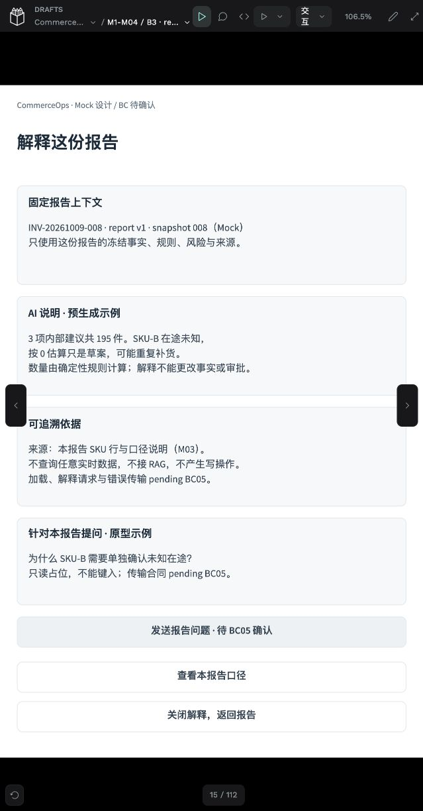
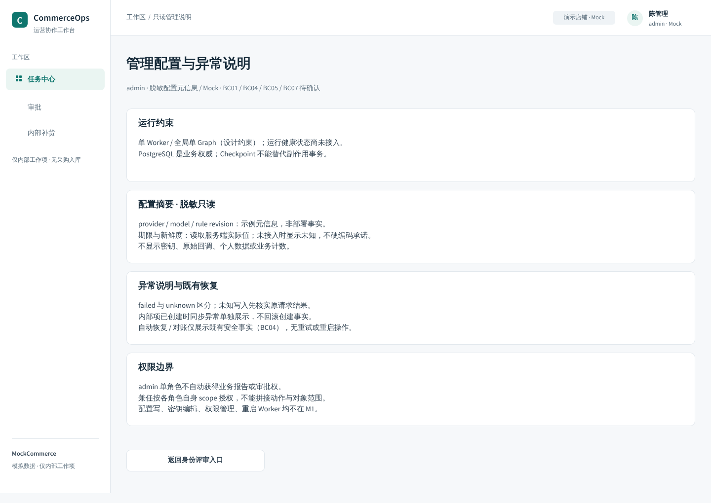
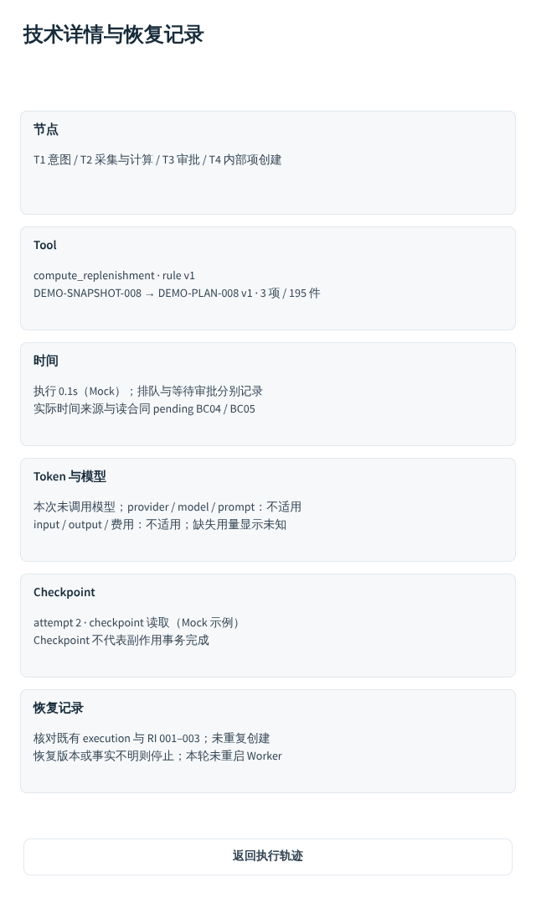

# C2-B3 · 最小收尾与 UX 设计冻结候选交付

实施：2026-10-09至10-10（Asia/Shanghai）。C1合同 `0.2.1-c1-revision`；设计候选 `m1-ui/0.4.0-b3`。用户确认B2外部产品与交互评审通过并授权B3。**本轮限定设计、合同、实际原型验证与交接已完成，等待最终外部评审及用户冻结/合并确认；没有合main，也不表示真实业务Gate通过。**

## 基线与范围

沿用 [PR #24](https://github.com/aning0922/commerceops-agent/pull/24)、原UX工作树和 `codex/ux-penpot-toolchain`，开始head `38b3e2578bf0dd4c1e509dabddf4e0a8320f8ee4`，main `a0d521ed79505287fa61bb6ddf82640e97824257`。B2会话「完成 C2-B2 身份与异常原型」idle，交付明确停写。本会话为唯一设计写入者。

正式file `7fd0f7d0-fdda-81c5-8008-c340d1377488`、主Page `7fd0f7d0-fdda-81c5-8008-c340d1377489`不变；原Foundations及状态Page不变。开始回读B2/revn45，先保存B2前置命名快照。复用18组件及33 Native Token，没有第二套设计系统，没有重建已有页面。

只修改UX文档、映射、证据和设计合同检查器；不修改Phase1/STATUS/ROADMAP、backend、共享锁、CI配置或正式Next.js。日报、SKU深析、运营风险、RAG均未制作。

## B2 局部修订

- 52个既有局部面板按内容收紧留白，保持UUID；390未知结果从760降至495px，冲突472px，期限/版本/重复及容量面板518px；正文与操作区顺序保留。
- 技术详情保留旧UUID，改为节点、Tool、时间、Token与模型、Checkpoint、恢复记录六组；默认仍为七个业务步骤，技术按需展开。未调用模型的字段显示不适用，usage缺失仍显示未知，Checkpoint不冒充副作用事务。
- 删除模型降级重复返回控件 `b806b597-0eb0-80b2-8008-c38740d37e69`，唯一返回实点通过；其他B2控件保留。
- 身份选择、评审索引、模拟响应明确标记review-only；正式账号菜单只展示当前身份、范围与退出，没有切换角色。51个评审控件有原生review-only标记，前端不得照搬为产品入口。
- F01当前直接决定仍禁用，保留1/20条完整清单及风险。明确G3条件：**客户端支持同版本完整披露后可直接审批，不支持/截断则转同版本Web并重新鉴权**；当前回退不是永久取消真实飞书审批。

## B3 页面与控件

新增15个实例：仅S08是新增1440页面，其余为局部面板/菜单。当前共18个逻辑页面、110个页面/布局/局部状态实例、322个原生控件；B01–B47全部对应声明，其中46个有原生实例，B09按合同不渲染。

| 逻辑页 | 本轮交付 |
|---|---|
| S08 | admin脱敏只读配置与异常说明；不含密钥编辑、权限管理、配置写或重启Worker |
| M04 | 指定report/version冻结上下文的解释、依据、受限问题占位与禁用发送；加载/失败/模板局部状态；无任意查数/RAG/写操作 |
| M05 | 待执行重算、拒绝/过期再发起、执行中/unknown核实、completed新周期；B36继续proposal禁用，无迁移成功演示 |
| F02 | 390px任务关联异步澄清Proposal，组织/聊天/发起人/任务/轮次与迟到/重复边界；B47禁用，无伪造续答API |
| 历史/新周期 | report版本列表及历史只读；completed→新草稿，不继承批准/nonce/假设/请求键，无task_id/排队；原open项约束保留 |
| 通用控件 | B30管理入口、B32报告问题、B34安全编号规格、B44账号菜单补齐；B34因原型无真实剪贴板能力禁用，前端另验 |

所有业务implementation仍not_implemented。BC01–BC07继续pending。报告B19/B06/B33是真实原型入口；M04口径overlay可打开/关闭；admin入口事件已修正为B30。报告局部评审按钮与摘要重叠已修复。

## 可供前端使用的交接

- [冻结候选与前端交接](ux-freeze-candidate.md)：18逻辑页面的Next.js路由、组件、数据需求、API依据/BC对应、Token/组件复用、导航合同、真实键盘/焦点/响应式/权限及G3验收。
- [当前全量设计映射](evidence/c2-b3/design-map.json)：110实例/322控件，UUID、owner Board、事件、实际navigation/overlay目标、禁用原因和review-only标记。
- [逻辑页面与全部事件索引](evidence/c2-b3/frontend-map.json)与 [screens.yaml](screens.yaml) / [interactions.yaml](interactions.yaml)：以当前B3映射为准，历史证据保留。
- [设计Token](design-tokens.json)：沿原M1 Token/组件使用；Native颜色绑定有回读，不宣称CSS自动同步或全部几何属性已绑定。

## 实际验证及失败记录

[Viewer事件](evidence/c2-b3/prototype-ui-events.json)共59条记录，含55次实际控件点击尝试：53次点击及结果断言通过，2次冲突断言使用错误预期v2而失败，保留并在第51条按原生既有v1只读回执复验通过。另有首次Viewer入口读取不完整失败，已在第55条刷新后复验。不是“所有尝试通过”。部分早期定位、浏览器接口及MCP失败单列 [工具失败](evidence/c2-b3/tool-failures.json)，不计为业务点击。

覆盖：报告实际解释/重算/历史入口及返回；加载/失败/模板；B36/B32/B47禁用点击保持当前面板；历史只读往返；completed原结果入口到新周期草稿、禁用创建与退出；admin到S08；账号打开/关闭/退出；轨迹六组详情与返回；390unknown/冲突只读核实；飞书Web回退无权拒绝；模型降级唯一返回；口径overlay打开/关闭。

六种390原生帧有独立帧名断言及Viewer截图，见 [观察](evidence/c2-b3/narrow-observations.json)。**内置浏览器实际clientWidth=639，1440/390视口设置请求未生效，不能声称真实浏览器断点验收。** 本轮证明的是390原生布局与Viewer交互；真实前端响应式仍待验。部分桌面Viewer截图受面板视口裁切，完整原生PNG用于布局审阅，不当作Viewer点击证据。

最终2482原生对象、407 flex、1481 token-bound，image fill=0；可见文字overflow、出Board和file.validate均为空；字号全部整数。当前与历史设计合同检查、Ruff lint/format、Markdown链接/围栏及Git差异检查实际通过；当前/index/完整可达历史敏感扫描0。没有运行真实业务、Next.js或飞书测试。

## 保存、刷新与私有备份

命名版本：`m1-ui/0.4.0-b3 / persisted UX freeze candidate · verified local auxiliary flows`，数据库及命名快照revn57（MCP API回报56），保存返回见 [记录](evidence/c2-b3/save-version.json)。[最终读取](evidence/c2-b3/final-read.json)与 [Viewer刷新后的MCP再读](evidence/c2-b3/after-reload-read.json)的全部页面/控件UUID及原型目标一致。

实际刷新了Viewer，并记录 [渲染UUID](evidence/c2-b3/after-reload-viewer.json)。Viewer DOM仅是当前已渲染对象子集，不拿其5个未渲染Board/40个未渲染控件推断文件丢失；全部UUID核对来自MCP两次全量读取。**本轮没有刷新当前连接的编辑器**，避免打断连接，证据明确标editorReloaded=false；Viewer刷新和数据库持久revn57提供独立保存观察。另有[命名快照元信息](evidence/c2-b3/persisted-version-metadata.json)独立确认最终命名快照也存储revn57；MCP File代理回报56，保留两种观察值，不强行改成一致。

停写后实际完成私有PG dump与assets备份，见 [摘要](evidence/c2-b3/backup-summary.json)：目录0700、文件0600，目录/tar成员可读，数据库持久revn57，digest完整。PG与assets顺序捕获，非跨存储原子快照；未作异机还原或原生.penpot round-trip，不把PNG当可编辑归档。备份/密钥/config正文不入Git。中断时备份另留历史摘要。

## 工具波折与操作事故

Chrome分组页签接口多次返回策略加载失败；最终使用本任务专用内置编辑器/Viewer与用户协助连接的MCP，未继续切换用户正常浏览页。批量字体还原曾超时，本会话一度过早判断需要停止，提交了中断记录 `f167bde`；用户要求继续后实际回读revn52/整数字号，确认超时请求已完成，再以小批局部修订完成全部目标。历史提交保留，当前状态已更新，不掩盖失败。

创建专用Chrome窗口时，原生paste误用了剪贴板中的本轮任务文本，触发Google搜索。已即时告知用户并用地址栏直接赋值修正到本机Penpot；后续不再使用原生粘贴。未发现发送凭据，但任务文本被意外传给Google的事实不能撤回，保留事故记录。

## 最终评审入口与停止

本轮设计写入已停止；更新同一PR #24并输出冻结候选，等待最终评审。不合main、不修改Phase1、不开发正式Next.js、不启动下一设计批次。设计候选通过不自动批准BC01–BC07或真实G3；前端和飞书真实验收清单保持开放。
